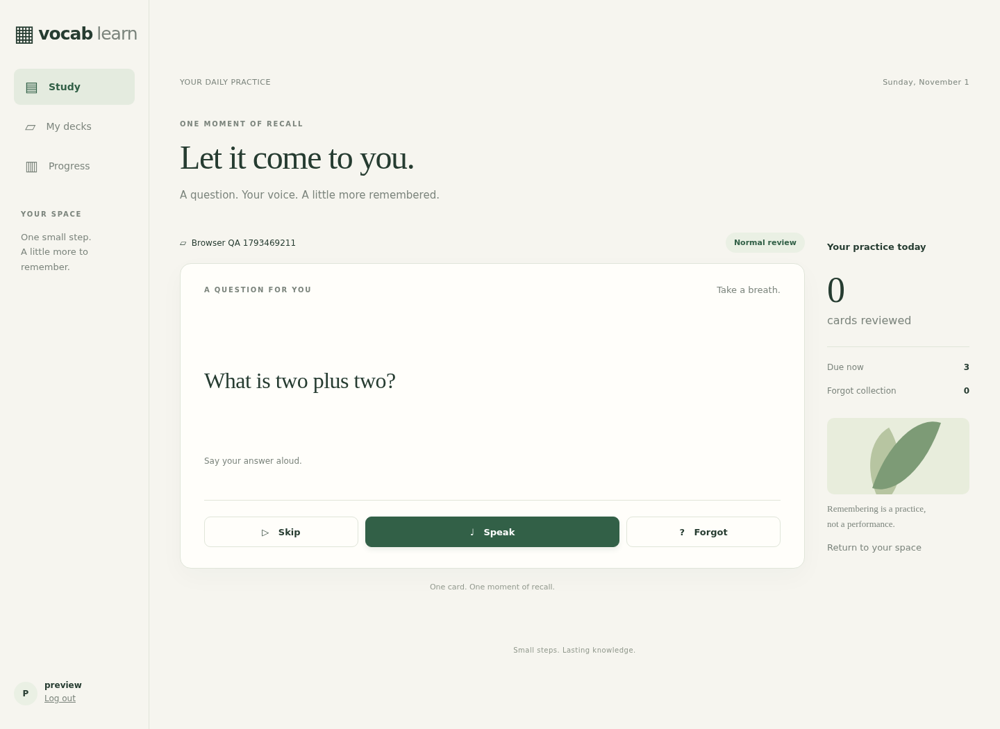

# Vocab-Learn

A browser application for continuous practice through flash cards, spoken answers and spaced repetition. V1 supports authored Generic Cards and Vocabulary Cards with AI-generated Recognition/Production examples.

V1 is implemented and available for user acceptance. The application uses Django 5.2, SQLite, FSRS and a bounded background worker, with independent ASR/Judge/Generator profiles and MiniMax defaults.



Start with the [running and maintenance guide](docs/operations.md). The [V1 Development Specification](docs/specs/v1.md) contains the agreed rules and acceptance cases; the [implementation acceptance record](docs/implementation/v1-acceptance.md) distinguishes automated, real-provider and browser evidence from remaining device-specific checks.

## Local start

Use Python 3.11 with FFmpeg/FFprobe on PATH. The requested development environment is `/home/rlan/anaconda3/envs/mykik_py311`. Export `MINIMAX_API_KEY` or the three task-specific credentials in each application/worker environment.

```sh
python -m pip install -r requirements.txt
python manage.py migrate
python manage.py createlearner your_username
python manage.py runserver 127.0.0.1:8766
```

Run `python manage.py runworker` in a second terminal. Open `http://127.0.0.1:8766`. Local commands read process environment variables; Compose reads `.env`.

## Compose deployment

For a new deployment, configure `.env` using `.env.example`: set a random Django secret, provider credentials, private LAN binding and hostname/origin. Then run:

```sh
docker compose build
docker compose up -d
docker compose exec web python manage.py createlearner your_username
```

The dedicated migration service completes before web/worker start. LAN microphone access requires the configured private HTTPS hostname and client trust in Caddy's public root certificate. The [operations guide](docs/operations.md) explains certificate export, per-client trust, account resets, independent model replacement, audio expiry, upgrades, and the delivered cold-backup/restore command.

## Development and verification

```sh
python -m pip install -r requirements-dev.txt
python manage.py test learning.tests --noinput
```

The tests include file-backed SQLite races, provider contracts, scheduling and worker resource recovery. Browser and live-provider probes are explicit opt-in checks; see the acceptance record and operations guide. New accounts start empty; a dedicated preview account may contain sample decks and synthetic acceptance history.

Evaluate Generator prompt changes with the [unedited-output regression workflow](docs/research/generator-prompt-evaluation.md). Content edited after generation does not establish that a prompt improved; compare frozen inputs, retain failed outputs and review meaning as well as format before promotion.

The [full-corpus review and 31-case benchmark](docs/research/generator-corpus-benchmark.md) records that comparison. The [explanation sense review](docs/research/explanation-sense-review.md) separates common-meaning selection and source correctness from generation quality.

The [scope-workflow experiment](docs/research/generator-scope-workflow-evaluation.md) records scope gains and language tradeoffs. The original D prompt is deployed at the user's request as `lexical-pair-v6-d`; D2 remains experimental and unpromoted. Existing examples and learning progress are retained.

## Reference

- [Domain glossary](CONTEXT.md)
- [CSV examples and authoring notes](docs/examples/README.md)
- [Completed decision map and planning history](docs/planning/v1/map.md)

Maintain current requirements in the development specification. The decision map and its resolved tickets preserve historical rationale.
