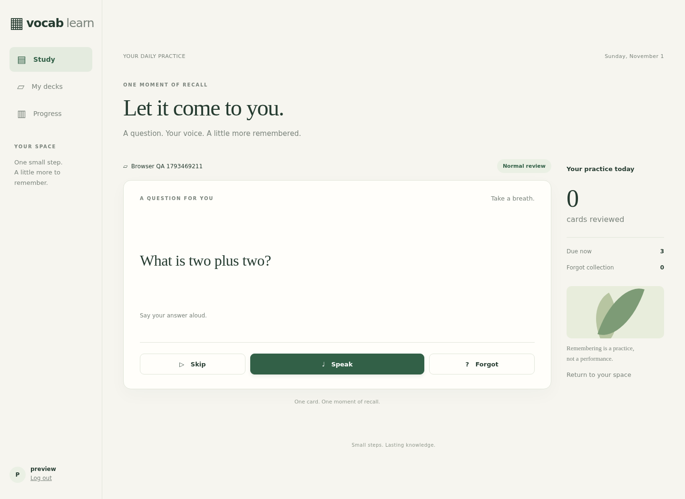
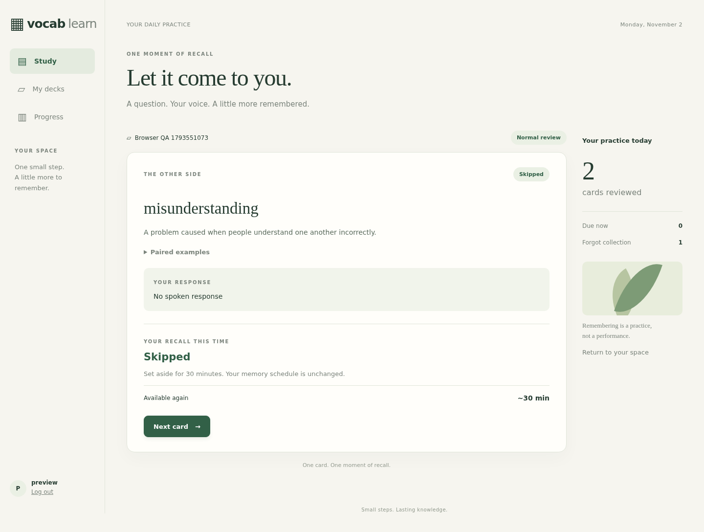

# V1 implementation and acceptance record

Status: implemented; user acceptance is pending. Recorded on 2026-11-01. The [development specification](../specs/v1.md) remains the source of product rules; [operations](../operations.md) covers installation, accounts, model configuration, HTTPS and backup/restore.

## Delivered application

- Private, deployer-managed accounts; private decks; manual authoring, editing, archive/restore and atomic CSV import for both card types.
- Generic whole-answer and multiple-blank cards, with one spoken response and safe Markdown. Vocabulary Cards prepare paired examples, share progress between balanced Recognition/Production directions, and rotate examples only at authorized recall boundaries.
- Browser recording, fixed submissions, immediate reference reveal after acceptance, read-only ASR text, AI unit judgments, the five agreed recall labels and a persisted Next review time.
- FSRS state plus the Forgot recovery schedule, continuous practice, 30-minute temporary deferrals, statistics and historical snapshots.
- Independent ASR/Judge/Generator profiles with MiniMax defaults, native and compatible transcription adapters, durable work, execution fencing, bounded worker processes, explicit recovery and audio expiry.
- The Fieldnotes interface, Docker Compose with private Caddy HTTPS and named volumes, account commands and a delivered cold-backup/restore procedure.

The application uses Django 5.2.18, Python 3.11, SQLite, fsrs 6.3.2 and markdown-it-py 4.0.0. FFmpeg performs actual audio conversion. Web and worker share the application image; database writes do not surround provider requests. Dependencies are pinned in [requirements.txt](../../requirements.txt).




## Executed verification

This table records the initial V1 delivery. The continuous-practice, Vocabulary lexical-meaning, generation-queue and Learning-D follow-ups below record later changes; the per-run shuffle follow-up is historical and superseded.

| Layer | Executed result | Evidence and scope |
| --- | --- | --- |
| Offline application | 41 tests passed in 14.739 seconds | [Recorded result](offline-results.json), [learning rules](../../learning/tests/test_learning.py), [provider contracts](../../learning/tests/test_providers.py), [file-backed concurrency and worker recovery](../../learning/tests/test_concurrency.py). Uses deterministic providers where application behavior is the subject. |
| Default live providers | 19 representative checks passed: 12 Judge, 3 ASR, 4 Generator | [Recorded inputs/outcomes and profile metadata](live-provider-results.json); [opt-in probe](../../scripts/probe_providers.py). Actual MiniMax endpoints/models, including authored-target versus substitute judgments, three response languages, all supported Vocabulary language pairs and replacement examples. |
| Browser workflow | 10 groups passed; no browser runtime errors | [Browser results](previews/browser-results.json), [executable smoke workflow](../../tests/browser_smoke.py), [screenshots](previews/). Headless Chromium used a synthetic microphone through the actual MediaRecorder, upload, FFmpeg, ASR and Judge pipeline. |
| Deployment | Application image built; web/worker/Caddy ran against named volumes; TLS, login, CSRF, secure session and packaged assets verified | Final runtime checks are recorded in [runtime-results.json](runtime-results.json). Only the configured private LAN HTTPS interface is published. |
| Delivered backup/restore | Cold snapshot restored into fresh project volumes; SQLite integrity and original CA identity verified | [Restore results](restore-results.json), [delivered procedure](../../ops/backup.py). Three controlled durable stages were present in the artifact; recovery was checked against those actual restored rows. |
| Static/configuration checks | Django checks, migration drift check, JavaScript syntax, Python compilation, Compose validation and whitespace checks passed | Commands below. Production Django checks silence only the documented private-host HSTS preload/subdomain warnings. |

Fake provider outputs prove state transitions and error handling; they do not prove linguistic correctness. Live fixtures provide representative semantic evidence, not a general accuracy score. Initial generation probes exposed factual drift and a wrong-language gloss; the delivered prompt and validation were tightened, and the four final generation checks were repeated successfully. A Judge rerun exposed non-English feedback and an over-generous partial-meaning result; the delivered prompt now explicitly requires English feedback and preserves missing defining distinctions. All 12 final Judge fixtures were rerun successfully. The recorded results contain the final outputs, prompt hashes and qualitative review.

### Reproduction

Use the requested environment, with its dependencies installed:

```sh
/home/rlan/anaconda3/envs/mykik_py311/bin/python manage.py test learning.tests --noinput
/home/rlan/anaconda3/envs/mykik_py311/bin/python manage.py check
/home/rlan/anaconda3/envs/mykik_py311/bin/python manage.py makemigrations --check --dry-run
/home/rlan/anaconda3/envs/mykik_py311/bin/python -m compileall -q learning vocab ops scripts tests
node --check static/review.js
docker compose config --quiet
docker compose exec web python manage.py check --deploy
git diff --check
```

Tests use a separate file-backed database. The browser script needs a dedicated account, running web/worker, Chromium and a supplied WAV; it creates and archives its own QA deck. Live probes and the browser recording check make real configured provider calls. Credentials, original audio, local databases and backup artifacts are deliberately excluded from version control. See operations for the exact browser/probe invocation and setup.

## Specification case map

The named specification cases are mapped below. This map identifies available implementation evidence; it does not declare that every fault permutation, browser and physical device in each case has been independently exercised. Remaining scope is explicit below the table.

`L` refers to [test_learning.py](../../learning/tests/test_learning.py), `P` to [test_providers.py](../../learning/tests/test_providers.py), `C` to [test_concurrency.py](../../learning/tests/test_concurrency.py), and `M` to [test_migrations.py](../../learning/tests/test_migrations.py). Method names below omit the common `test_` prefix. `Browser`, `Live` and `Restore` refer to the corresponding executed evidence above.

| Specification case | Evidence |
| --- | --- |
| ENTRY-CSV-DEDUP | L: `csv_duplicate_and_independent_atomic_rollback`, `csv_multiline_schema_and_same_language_validation`. |
| ENTRY-CSV-ROLLBACK | L: `csv_duplicate_and_independent_atomic_rollback`; valid new rows precede an invalid row in an independent deck. |
| PREP-INITIAL | L: `first_preparation_failure_keeps_source_out_of_queue`; Browser: manual Vocabulary creation and actual preparation. |
| FLOW-ACTIONS | L: `actions_are_unique_and_voice_is_required`; Browser: all three actions, accepted upload before back reveal. |
| GENERIC-WHOLE | L: `actions_are_unique_and_voice_is_required`, `short_sentence_and_invalid_audio_remain_whole_tasks`; Browser: spoken zero-blank arithmetic answer. |
| GENERIC-MULTI | L: `judgment_precedence_and_time_boundary`; P: exact unit-set validation; Live: target/substitute and full-sentence fixtures. |
| GENERIC-TARGET-LIVE | Live: `GENERIC-MULTI`, `GENERIC-TARGET-LIVE`, `GENERIC-SENTENCE` recorded actual Judge outcomes. |
| VOCAB-GRADING | L: unit precedence/time boundaries; Live: native equivalents, partial and wrong meaning, target, suitable substitute and wrong-sense production. |
| LANGUAGE-DIRECTIONS | L: `language_pairs_directions_and_actions_are_separate_dimensions` covers 3 pairs × 2 directions × 3 actions; Live: 3 language ASR and all-pair generation probes. |
| SRS-TIMELINE | L: `forgot_timeline_and_preserved_scheduler_memory`, `actual_due_clock_all_eight_graduation_routes`; controlled clock advances to the saved due. |
| LEARNING-D-INTERVAL | L: `learning_d_uses_one_to_three_days_and_preserves_memory_and_replay`, `learning_d_after_c_changes_only_d_and_keeps_e_history_adaptive`, `mature_d_and_all_e_keep_native_fsrs_schedule`, `database_only_retry_reuses_judgment_and_fuzzed_candidate`; Forgot timeline checks reject D-day sampling. Browser: actual slow complete speech receives D and a saved day-scale Next review. |
| PAIR-ROTATION | L: `direction_slots_and_pair_lock_race`, `pair_activation_before_question_preserves_progress`, `forgot_rotation_third_d_vs_e`; Live: changed replacement sentences. |
| QUEUE-PRACTICE | L: `skip_defers_for_thirty_minutes_without_changing_learning_progress`, `new_cards_are_random_and_only_displayed_question_is_fixed`, `queue_preserves_review_due_order_and_candidate_scope`, `new_ready_cards_join_without_changing_displayed_question`, `empty_practice_rechecks_ready_cards_and_snoozed_availability`, `unassessed_exit_is_idempotent_and_stale_work_cannot_snooze_new_progress`; C: concurrent entry resumes one question. |
| DIRECTION-BLOCK | L: `normal_direction_waits_for_complete_recall`, `forgot_direction_stays_locked_until_graduation`, `incomplete_direction_survives_neutral_actions_and_stale_tabs`, `direction_slots_and_pair_lock_race`, `language_pairs_directions_and_actions_are_separate_dimensions`. Browser: the exact Vocabulary cue/language returns after its actual one-minute Forgot interval. |
| DIRECTION-UPGRADE | M: `direction_upgrade_relocks_only_incomplete_unheld_current_sources`, including repeat application, held cues, corrected examples and old-source history. |
| ACCOUNT-METRICS | L: `ownership_all_surfaces_and_post_csrf`, `metrics_history_and_all_pages_render`; Browser: distinct cards/reviews/accuracy; production HTTPS login. |
| PROVIDER-CONTRACT | P: native/form routing, safe final JSON, reasoning/refusal/errors/unit validation, redirects and bounded trickle; L: cached-transcript Retry. |
| AUDIO-NORMALIZE | L: `pipeline_normalizes_reuses_transcript_and_cleans_on_commit`, `short_sentence_and_invalid_audio_remain_whole_tasks`; Browser: complete MediaRecorder WebM to PCM WAV. Exact 500/501-second and over-50-MB fixtures included. |
| MARKDOWN-UI | L: `safe_markdown_exact_units_and_identity`; Browser: bold/underline clozes, styled pages, no horizontal overflow/runtime errors; screenshots. |
| EXIT-FIRST | L: `exit_first_and_grade_first_are_atomic_terminal_winners`; C: separate-connection exit/grade competition. |
| GRADE-FIRST | Same terminal-order tests; committed result replay in Restore. |
| EXIT-ACK | L: idempotent terminal actions and `unconfirmed_upload_can_close_before_a_late_submission`; Browser: explicit recovery states. |
| NEVER-STARTED | L: `never_started_and_expired_execution_fencing`; status expires unclaimed execution without a running worker. |
| EXPIRED-EXECUTION | L: `never_started_and_expired_execution_fencing`; old claim cannot commit after Retry. |
| PAIR-LOCK-RACE | L: `direction_slots_and_pair_lock_race`; candidate arrival while an old question is retained does not change that question's logical progress. |
| GEN-UNSTARTED | L: `first_preparation_failure_keeps_source_out_of_queue`, `bulk_generation_waits_for_capacity_without_spending_execution_budget`; 1,201 sources wait two hours and receive fresh budgets only at claim. C: `concurrent_generation_claims_are_distinct`, `aged_generation_queue_executes_after_all_slots_recover`. |
| GEN-CLAIMED | L: `generation_claim_crash_replay_and_old_source`, `generation_retry_waits_then_starts_a_fresh_execution`, `cancelled_generation_does_not_dispatch_or_commit`; expired claimed generation is explicitly retried and old claims cannot commit. |
| GEN-BULK-RECOVERY | L: `explicit_preparation_requeue_is_scoped_and_idempotent`; migration test `generation_migration_only_removes_queued_deadlines_and_preserves_failed_work`; actual cold-artifact rehearsal and production recovery preserve sources/progress/history and reuse existing jobs. |
| GEN-COMMITTED | L: `generation_claim_crash_replay_and_old_source`, `direction_slots_and_pair_lock_race`; saved pair replay remains idempotent. |
| GEN-STALE | L: `generation_claim_crash_replay_and_old_source`; learning-content edit keeps fresh source outside Ready until its own pair is accepted. |
| WORKER-CAPACITY | C: `worker_recovers_actual_capacity_after_stalled_provider`, `worker_kills_and_reaps_stalled_conversion_child`; sole-slot conversion/provider scenarios complete before the asserted second-7 target and conversion PID is absent after cleanup. `aged_generation_queue_executes_after_all_slots_recover` occupies both generation slots; the aged healthy request completes in 6.450 seconds with a fresh budget. |
| TWO-ATTEMPTS | L: `distinct_attempts_and_source_edit_fence`; C: `two_real_connections_cannot_both_score_same_progress`. Loser closes without another score. |
| SOURCE-EDIT | L: `distinct_attempts_and_source_edit_fence`, `pipeline_closes_stale_attempt_before_more_paid_work`; old work cannot score reset progress. |
| SAME-WORD | L: `independent_same_word_cards_preserve_other_progress`, `format_only_edits_preserve_progress`; reviewing one sense does not update the other card. |
| UNIT-IDENTITY | L: exact F-MD AST fixture yields ordered visible IDs 1/2; P: missing/duplicate/provider-invalid units versus an explicitly unanswered unit. |
| CLOCK-BOUNDARY | L: `judgment_precedence_and_time_boundary`: 11.99/12/12.01 seconds and fast/slow partial answers. |
| CLOCK-REFRESH | Browser: Cancel plus same-presentation refresh retains elapsed time. |
| CLOCK-LOST | Browser: missing clock and uncertain pending upload disable Speak and require explicit Restart question. |
| DELAY-ANCHOR | L: `timing_frozen_through_retry_and_schedule_uses_receipt`; saved duration and original server receipt survive Retry. |
| PERMISSION-PENDING | Browser: unsettled permission remains cancellable, obsolete grants stop both tracks, late rejection cannot replace newer UI. |
| RESTORE-NO-AUDIO | Restore: actual audio-excluding cold artifact; missing recording fails technically and closes without a score. |
| RESTORE-TRANSCRIPT | Restore: actual cached text survives; Judge-only Retry succeeds with ASR deliberately unreachable and retains original ASR provenance. |
| RESTORE-COMMITTED | Restore: actual committed E/due replays once; duplicate processing does not create another scored row. |
| AUDIO-COMMIT | L: `pipeline_normalizes_reuses_transcript_and_cleans_on_commit`; durable text exists after Judge failure, audio remains until scored commit, cleanup follows. |
| AUDIO-TTL | L: `never_started_and_expired_execution_fencing`; Restore: original timestamps/expiry retained; operations documents startup/minutely physical deletion and audio exclusion. |
| NEXT-REVIEW | L: saved due, elapsed Due now and submission-anchor checks; Browser: saved result shown after real judgment and one-minute Forgot due. |
| ARCHIVE-RESTORE | L: `archive_restore_does_not_revive_old_execution`, `independent_same_word_cards_preserve_other_progress`, `format_only_edits_preserve_progress`; Browser: own deck archive. |
| PROFILE-DISPATCH | L: `profile_dispatch_snapshot_retry_and_cached_asr_provenance`; P: independent settings/native versus compatible wire contracts/default-key origin restriction; actual MiniMax profiles in Live. |
| PRACTICE-MIGRATION | `test_migrations.py`: previous-schema scored history, cached transcript, scoped/all-deck presentations, recent/expired/stale deferrals; actual versioned migration, table removal and foreign-key integrity checks. |
| VOCAB-LEXICAL | P: `vocabulary_judge_uses_authored_meaning_and_only_visible_context`; L: `vocabulary_back_uses_authored_target_and_explanation_for_legacy_and_new_reviews`; [live lexical probes](lexical-provider-results.json); Browser: original English Vocabulary back. |
| EXAMPLE-CORRECTION | L: `example_correction_preserves_held_question_then_replaces_retained_cue`, `example_correction_is_source_fenced_and_keeps_submissions_in_other_scopes`, `refresh_command_scopes_ready_cards_and_retries_only_remaining_failures`; migration test `removing_generated_gloss_preserves_pair_and_frozen_history`; actual cold-artifact rehearsal and production field comparisons. |

## Backup/restore evidence details

The executed command was the delivered `ops/backup.py create`, followed by `restore` into a new Compose project with fresh volumes. The manifest's procedure hash matches [the delivered source](../../ops/backup.py); [restore-results.json](restore-results.json) records that hash and the exact image used for the drill. The artifact is private and ignored under `backups/v1-acceptance-final`; it is not a hand-assembled test database copy.

The source contained three deliberately controlled stages: accepted recording without durable transcript; durable transcript without a committed judgment; committed grade before acknowledgment. Following restore, temporary audio was absent, original receipt/expiry remained fixed, and each stage recovered as specified. Judge-only recovery used the real default Judge with an unreachable ASR endpoint to check it could not silently transcribe again. The restored CA public certificate was byte-identical, and an HTTPS request using the original root verified the restored hostname. The isolated restore project and its test volumes were then removed; normal project volumes were retained.

The drill image precedes the final stale-work/unconfirmed-upload fixes, which do not change the schema or backup procedure. The final runtime image is separately recorded in runtime-results.json. Restore requires the exact image recorded in its own manifest before upgrades; do not replace a drill artifact's matching image with a rebuilt tag.

## Remaining user/device acceptance

- Test real microphones in desktop Chrome and Edge on the intended clients. Synthetic/headless Chromium cannot establish microphone hardware quality, device selection, real permission dialogs or Edge behavior.
- Configure name resolution and trust the exported Caddy public root on each LAN client, then confirm warning-free HTTPS and actual recording. Server-side hostname/chain verification has passed; no other device's trust store has been installed or verified automatically.
- Complete the product acceptance pass using the 51 specification cases and these evidence references. Some tests combine cases or exercise representative branches: exact 9+2+1-second browser refresh arithmetic, every delayed rotation winner, every crash instruction boundary and live hot replacement of all three providers have not all been individually replayed.
- Review language quality on personal learning material. All three configured default tasks worked on representative public fixtures; the compatible ASR route has contract-test coverage, not a live certification of every provider. This release makes no measured long-term retention or broad ASR/Judge accuracy claim.

No public registration, additional UI languages, answer typing, sharing/marketplace, LiteLLM layer, mobile app or public-cloud deployment was added; those remain outside the agreed V1 boundary.

## Per-run new-card shuffle follow-up (superseded)

Implemented on 2026-11-01: Ready unseen Generic and Vocabulary Cards use a stable hash of the run UUID and card ID. New runs independently reshuffle; Resume retains the ordering rule. Newly Ready cards join dynamically without replacing a displayed question. Due Forgot and reviewed Normal cards retain their existing priority and earliest-due/card-ID ordering. The change is contained in `queue(run)` and needs no schema migration.

Verification: all 45 automated tests passed, including four new regressions for per-run stability/import-order independence, reviewed-card priority and candidate isolation, dynamic readiness with frozen presentations, and deferrals/saved schedules. All 10 Chromium browser groups passed with the real configured providers. The browser fixtures are now introduced as needed during the run rather than assuming CSV insertion order. Production HTTPS health and deployment checks passed; the deployed queue source matches the repository, and learner progress and generation-state fingerprints were unchanged across deployment.

The initial provider-probe and cold-restore artifacts above remain records of the original delivery. Bulk-generation queue deadlines and failed-task retries were outside this follow-up and were not changed.

## Continuous-practice follow-up

Implemented on 2026-11-01 following [ADR 0001](../adr/0001-continuous-practice.md): remove StudyRun and run-local Deferral, resume the current question for the selected scope, randomly select unseen Ready cards as needed, and temporarily defer Skip/confirmed unassessed exit for 30 minutes. There is no saved future order or finished state. Existing review priorities, FSRS state, balanced directions, fixed submissions and historical assessments remain.

[Verification results](continuous-practice-results.json) record 49 passing automated tests and 11 passing Chromium browser groups with a synthetic microphone and real configured providers. Coverage includes same-scope concurrent entry, exact deferral expiry/idempotency, stale-work protection, empty-queue rechecking, dynamic readiness, and the actual previous-schema migration. Browser fixtures no longer create or finish runs; a newly prepared Vocabulary Card enters through the same previously empty Practice URL.

Before production migration, the delivered cold-backup command produced a private snapshot and its matching old image was retained. That actual artifact was restored into an isolated volume and migrated successfully. Rehearsal and production checks compared all existing fields of users, decks, cards, example pairs, presentations, attempts, scored reviews and generation jobs, excluding the intentionally removed run foreign key. Selected presentation scopes were compared separately; all matched. SQLite integrity/foreign keys passed, obsolete tables were absent, and the deployed sources, trusted HTTPS, login and private pages were verified. The temporary rehearsal volume was removed; the private backup remains under ignored `backups/`.

Bulk-generation queue timeout handling and failed-task retries remain unchanged. Physical microphone and Edge checks were not repeated. Legacy unassessed closures have no separate closure timestamp; their migration deferral uses the original saved submission time, as documented in operations.

## Vocabulary lexical-meaning follow-up

Implemented on 2026-11-02 following [ADR 0002](../adr/0002-authored-vocabulary-meaning.md): generate only aligned sentences and minimal lexical highlights, prefer precise conventional translations, and grade Recognition against the authored explanation/visible context. Concise equivalents such as 吸收 are complete; genuine imprecision remains partial, and Production still requires the authored target. Both backs show the original word/explanation. The removed ExamplePair.gloss is neither a new teaching definition nor a new judgment reference; old snapshot JSON and grades remain intact.

The [lexical provider probes](lexical-provider-results.json) record representative semantic evidence and development failures caught by structural validation. Inspection also exposed derived target forms and Chinese highlight particles absent from their sentence. The final prompt explicitly permits inflection without derivation. The provider adapter now extracts highlights from inline focus markers in two generated sentences rather than trusting separately generated span strings; it returns the same four plaintext application fields. Missing/empty/repeated/reversed markers and repeated expressions are rejected. Field/span validation does not establish linguistic accuracy.

The explicit `refresh_examples` command corrects older Ready pairs with at most two concurrent provider requests and serial, source-fenced persistence. It preserves unfinished presentations/submissions across scopes, supports repeated corrections before a held question resolves, cancels obsolete rotation work and leaves failed calls' old pairs available. Not-ready cards and initial-generation jobs are excluded; successful corrections are skipped on rerun. No automatic paid retry or learner-facing configuration was added.

[Verification results](lexical-results.json) record 55 passing automated tests, 21 passing Judge cases, 11 Generator cases reaching valid reviewed output, and 12 passing Chromium workflow groups with real configured providers and a synthetic microphone. One Generator response omitted the required markers, was rejected, and passed an explicit operator rerun; the [provider evidence](lexical-provider-results.json) retains that failed attempt. The actual historical absorb/吸收 snapshot was separately reassessed as complete without rewriting its saved C grade. Browser checks verify the original English explanation and that focus markers do not reach the page.

Before the schema upgrade, the delivered cold-backup command saved the original data and its matching image was retained. The actual backup was restored into an isolated volume and migrated; rehearsal and production comparisons matched every field except the intentionally removed ExamplePair.gloss, including historical JSON, scopes, accounts, source/progress, attempts and generation jobs. SQLite integrity and foreign keys passed. The rehearsal volume was removed and the private backup remains ignored under `backups/`.

All 75 existing Ready cards for the selected learner received new pair revisions, followed by two word-class corrections found during inspection. Original source/progress/history and old-pair fingerprints remained unchanged, excluding authorized active/cue pointers and superseded rotation intent. The 1,126 not-ready sources and all initial-generation jobs were untouched; rerun preview reports zero remaining old Ready pairs. The final inline-marker refinement changes only the provider wire format, so these normalized plaintext pairs remain usable. Trusted HTTPS, login/CSRF/secure session, private pages/assets and deployed runtime source hashes passed. Physical microphones and Edge were not retested; linguistic quality remains model-dependent.



## Generation-queue execution-budget follow-up

Implemented on 2026-11-02 following [ADR 0003](../adr/0003-generation-clock-at-claim.md). Background generation now waits durably in Queued with no start/deadline. `claim_work()` atomically starts a bounded execution and returns the same worker interface; the supervisor retains its two-slot limit and real process/transport cleanup. Spoken assessment deadlines still start at submission and retain priority for available slots. Retry requeues generation without consuming its next execution budget, and expired/cancelled claims cannot dispatch or commit new output.

[Verification results](generation-queue-results.json) record 63 passing automated tests and 12 passing Chromium groups using a synthetic microphone and the actual configured ASR/Judge/Generator. The controlled bulk fixture imports 1,201 sources, advances two hours, claims two and verifies that waiting consumes no execution budget. Separate-connection claims are distinct. With both generation slots stalled, the healthy aged request completes in 6.450 seconds; the existing assessment/conversion recovery checks also pass. Model prompts, semantic grading and SRS rules were not changed in this follow-up.

The delivered cold backup and its matching old image were retained. That actual artifact was restored into an isolated volume, migrated, and used to rehearse the explicit `requeue_preparation` command with network disabled. Field comparisons use column names because SQLite table rebuilding may change column order. Migration preserves all old fields except queued deadlines, leaves historical start times unknown, and does not automatically retry failed work. Recovery reuses the 1,126 existing failed initial jobs, preserves all source/card/pair/presentation/attempt/review data and other jobs, and produces a zero-candidate preview before the worker resumes. Production migration/recovery passed the same checks, with SQLite integrity/foreign keys intact; the isolated volume was removed.

Trusted HTTPS, login/CSRF/secure session, private pages/assets and deployed source hashes passed. Live observations cover a backlog waiting beyond five minutes with no queued deadlines, while new Ready pairs continue arriving and active executions receive full budgets. Background generation continues after this deployment; actual provider/validation failures remain explicit Failed requests for operator/learner Retry rather than automatic paid replays. Physical microphones and Edge were not retested.

## Normal Learning-D interval follow-up

Implemented on 2026-11-03: replace the minute-scale due only when Normal D still leaves the card in FSRS Learning. Select 1, 2 or 3 elapsed days once from the original submission anchor, and preserve the native stability, difficulty, state, learning step and log. When D completes Learning and enters Review, keep its native adaptive interval. E, C, Forgot and their history-sensitive behavior remain unchanged; existing saved schedules and reviews are not recalculated.

[Verification results](learning-d-results.json) record 66 passing automated tests and 12 passing Chromium workflow groups. Tests cover all three day choices, Generic/Vocabulary, D after C, unchanged short E after C, native fresh E and mature D/E, Forgot success timing, result replay and database-only retry without resampling. The browser waits beyond the quick-recall budget before speaking through the actual MediaRecorder/FFmpeg/ASR/Judge path, verifies Correct recall and a day-scale Next review, and retains the original English Vocabulary explanation.

The original image and a delivered cold backup were retained before deployment. No schema migration or rescheduling operation was needed; before/after fingerprints matched every stored field of accounts, sources, progress, example pairs, presentations, attempts, scored reviews and generation jobs. Trusted HTTPS, secure login/private pages/assets and deployed source hashes passed. Physical microphones and Edge were not retested for this scheduling change.

## Direction recovery follow-up

Implemented on 2026-11-03 following [ADR 0004](../adr/0004-direction-unlock-after-recovery.md). Consume a Vocabulary direction slot only when D/E results in Normal. Normal C retains the cue; A/B enters Forgot without changing it. All results remaining in Forgot retain direction/pair, including the first two D/E successes and A/B/C streak resets. The third consecutive success releases the direction through graduation. Existing randomized direction blocks, shared FSRS memory/due, neutral-action deferral and E-only example rotation remain in place. Balance now applies to completed direction stages rather than attempt counts; graduation establishes recovery in the locked direction.

[Verification results](direction-lock-results.json) record 70 passing automated tests and 13 passing Chromium workflow groups. Controlled-clock cases cover both directions and block positions, repeated Normal C, D/E completion, Forgot entry/reset/graduation, unchanged minute/day intervals, rotation eligibility, replay, Retry/Skip/unassessed interruption and stale other-scope tabs. The browser uses real ASR/Judge/Generator with a synthetic microphone and actually waits for the one-minute Forgot due; the same Vocabulary cue/language returns without accelerating or rewriting its schedule.

Migration `0007_retain_incomplete_directions` restores cleared incomplete locks from the latest scored current-source direction and current active example, preserving held cues and explicit quality corrections. The matching original image and a cold backup were retained. That backup was restored into an isolated volume and upgraded with network disabled under the application UID before production upgrade. Both runs restored 22 legacy locks and matched exact rows/fields across eight application tables, allowing only the three intended direction index/cue fields to differ. Due/memory, collection/streak, progress/counts, accounts, sources, pairs, presentations, attempts, history and jobs were preserved; repeated upgrade and SQLite integrity/foreign keys passed. The isolated volume was removed. Trusted HTTPS, login/CSRF/secure session, private pages/assets and deployed application source hashes passed. Physical microphones and Edge were not retested.
