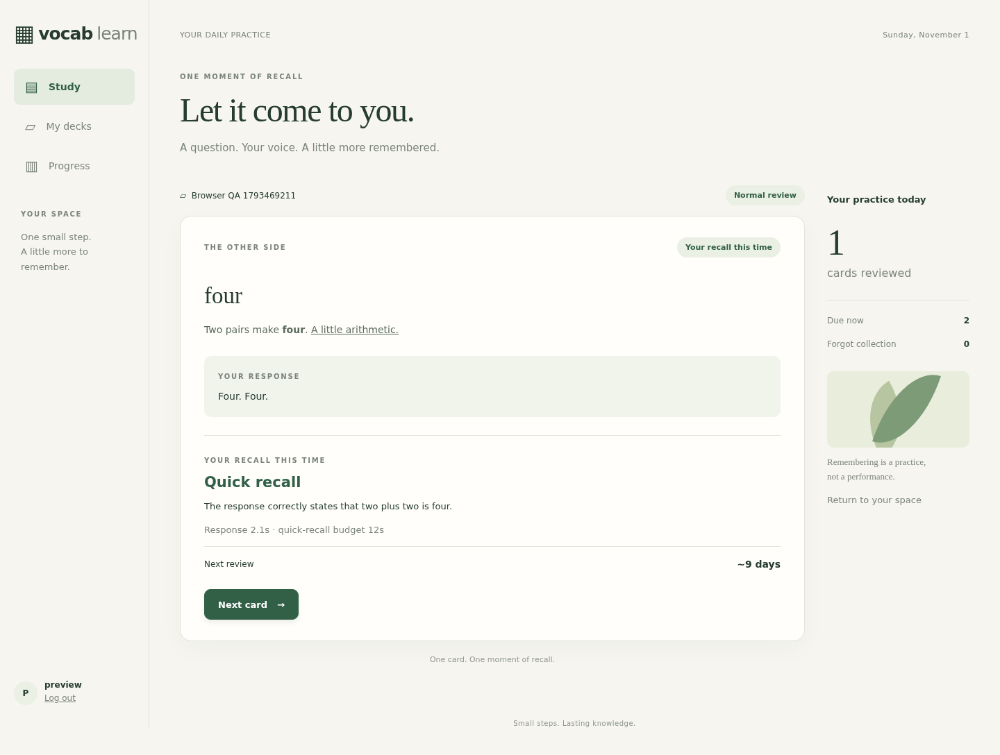

# V1 implementation and acceptance record

Status: implemented; user acceptance is pending. Recorded on 2026-11-01. The [development specification](../specs/v1.md) remains the source of product rules; [operations](../operations.md) covers installation, accounts, model configuration, HTTPS and backup/restore.

## Delivered application

- Private, deployer-managed accounts; private decks; manual authoring, editing, archive/restore and atomic CSV import for both card types.
- Generic whole-answer and multiple-blank cards, with one spoken response and safe Markdown. Vocabulary Cards prepare paired examples, share progress between balanced Recognition/Production directions, and rotate examples only at authorized recall boundaries.
- Browser recording, fixed submissions, immediate reference reveal after acceptance, read-only ASR text, AI unit judgments, the five agreed recall labels and a persisted Next review time.
- FSRS state plus the Forgot recovery schedule, explicit study runs, run-only deferrals, statistics and historical snapshots.
- Independent ASR/Judge/Generator profiles with MiniMax defaults, native and compatible transcription adapters, durable work, execution fencing, bounded worker processes, explicit recovery and audio expiry.
- The Fieldnotes interface, Docker Compose with private Caddy HTTPS and named volumes, account commands and a delivered cold-backup/restore procedure.

The application uses Django 5.2.18, Python 3.11, SQLite, fsrs 6.3.2 and markdown-it-py 4.0.0. FFmpeg performs actual audio conversion. Web and worker share the application image; database writes do not surround provider requests. Dependencies are pinned in [requirements.txt](../../requirements.txt).




## Executed verification

This table records the initial V1 delivery. The [per-run shuffle follow-up](#per-run-new-card-shuffle-follow-up) records verification of the subsequent ordering change.

| Layer | Executed result | Evidence and scope |
| --- | --- | --- |
| Offline application | 41 tests passed in 14.739 seconds | [Recorded result](offline-results.json), [learning rules](../../learning/tests/test_learning.py), [provider contracts](../../learning/tests/test_providers.py), [file-backed concurrency and worker recovery](../../learning/tests/test_concurrency.py). Uses deterministic providers where application behavior is the subject. |
| Default live providers | 19 representative checks passed: 12 Judge, 3 ASR, 4 Generator | [Recorded inputs/outcomes and profile metadata](live-provider-results.json); [opt-in probe](../../scripts/probe_providers.py). Actual MiniMax endpoints/models, including authored-target versus substitute judgments, three response languages, all supported Vocabulary language pairs and replacement examples. |
| Browser workflow | 10 groups passed; no browser runtime errors | [Browser results](previews/browser-results.json), [executable smoke workflow](../../tests/browser_smoke.py), [screenshots](previews/). Headless Chromium used a synthetic microphone through the actual MediaRecorder, upload, FFmpeg, ASR and Judge pipeline. |
| Deployment | Application image built; web/worker/Caddy ran against named volumes; TLS, login, CSRF, secure session and packaged assets verified | Final runtime checks are recorded in [runtime-results.json](runtime-results.json). Only the configured private LAN HTTPS interface is published. |
| Delivered backup/restore | Cold snapshot restored into fresh project volumes; SQLite integrity and original CA identity verified | [Restore results](restore-results.json), [delivered procedure](../../ops/backup.py). Three controlled durable stages were present in the artifact; recovery was checked against those actual restored rows. |
| Static/configuration checks | Django checks, migration drift check, JavaScript syntax, Python compilation, Compose validation and whitespace checks passed | Commands below. Production Django checks silence only the documented private-host HSTS preload/subdomain warnings. |

Fake provider outputs prove state transitions and error handling; they do not prove linguistic correctness. Live fixtures provide representative semantic evidence, not a general accuracy score. Initial generation probes exposed factual drift and a wrong-language gloss; the delivered prompt and validation were tightened, and the four final generation checks were repeated successfully. A Judge rerun exposed non-English feedback and an over-generous partial-meaning result; the delivered prompt now explicitly requires English feedback and preserves missing defining distinctions. All 12 final Judge fixtures were rerun successfully. The recorded results contain the final outputs, prompt hashes and qualitative review.

### Reproduction

Use the requested environment, with its dependencies installed:

```sh
/home/rlan/anaconda3/envs/mykik_py311/bin/python manage.py test learning.tests --noinput
/home/rlan/anaconda3/envs/mykik_py311/bin/python manage.py check
/home/rlan/anaconda3/envs/mykik_py311/bin/python manage.py makemigrations --check --dry-run
/home/rlan/anaconda3/envs/mykik_py311/bin/python -m compileall -q learning vocab ops scripts tests
node --check static/review.js
docker compose config --quiet
docker compose exec web python manage.py check --deploy
git diff --check
```

Tests use a separate file-backed database. The browser script needs a dedicated account, running web/worker, Chromium and a supplied WAV; it creates and archives its own QA deck. Live probes and the browser recording check make real configured provider calls. Credentials, original audio, local databases and backup artifacts are deliberately excluded from version control. See operations for the exact browser/probe invocation and setup.

## Specification case map

All 45 named cases are mapped below. This map identifies available implementation evidence; it does not declare that every fault permutation, browser and physical device in each case has been independently exercised. Remaining scope is explicit below the table.

`L` refers to [test_learning.py](../../learning/tests/test_learning.py), `P` to [test_providers.py](../../learning/tests/test_providers.py), and `C` to [test_concurrency.py](../../learning/tests/test_concurrency.py). Method names below omit the common `test_` prefix. `Browser`, `Live` and `Restore` refer to the corresponding executed evidence above.

| Specification case | Evidence |
| --- | --- |
| ENTRY-CSV-DEDUP | L: `csv_duplicate_and_independent_atomic_rollback`, `csv_multiline_schema_and_same_language_validation`. |
| ENTRY-CSV-ROLLBACK | L: `csv_duplicate_and_independent_atomic_rollback`; valid new rows precede an invalid row in an independent deck. |
| PREP-INITIAL | L: `first_preparation_failure_keeps_source_out_of_queue`; Browser: manual Vocabulary creation and actual preparation. |
| FLOW-ACTIONS | L: `actions_are_unique_and_voice_is_required`; Browser: all three actions, accepted upload before back reveal. |
| GENERIC-WHOLE | L: `actions_are_unique_and_voice_is_required`, `short_sentence_and_invalid_audio_remain_whole_tasks`; Browser: spoken zero-blank arithmetic answer. |
| GENERIC-MULTI | L: `judgment_precedence_and_time_boundary`; P: exact unit-set validation; Live: target/substitute and full-sentence fixtures. |
| GENERIC-TARGET-LIVE | Live: `GENERIC-MULTI`, `GENERIC-TARGET-LIVE`, `GENERIC-SENTENCE` recorded actual Judge outcomes. |
| VOCAB-GRADING | L: unit precedence/time boundaries; Live: native equivalents, partial and wrong meaning, target, suitable substitute and wrong-sense production. |
| LANGUAGE-DIRECTIONS | L: `language_pairs_directions_and_actions_are_separate_dimensions` covers 3 pairs × 2 directions × 3 actions; Live: 3 language ASR and all-pair generation probes. |
| SRS-TIMELINE | L: `forgot_timeline_and_preserved_scheduler_memory`, `actual_due_clock_all_eight_graduation_routes`; controlled clock advances to the saved due. |
| PAIR-ROTATION | L: `direction_slots_and_pair_lock_race`, `pair_activation_before_question_preserves_progress`, `forgot_rotation_third_d_vs_e`; Live: changed replacement sentences. |
| QUEUE-RUN | L: `mixed_queue_deferral_and_explicit_run_lifecycle`; Browser: finished run survives refresh, Skip does not score. |
| DIRECTION-BLOCK | L: `direction_slots_and_pair_lock_race`, `language_pairs_directions_and_actions_are_separate_dimensions`. |
| ACCOUNT-METRICS | L: `ownership_all_surfaces_and_post_csrf`, `metrics_history_and_all_pages_render`; Browser: distinct cards/reviews/accuracy; production HTTPS login. |
| PROVIDER-CONTRACT | P: native/form routing, safe final JSON, reasoning/refusal/errors/unit validation, redirects and bounded trickle; L: cached-transcript Retry. |
| AUDIO-NORMALIZE | L: `pipeline_normalizes_reuses_transcript_and_cleans_on_commit`, `short_sentence_and_invalid_audio_remain_whole_tasks`; Browser: complete MediaRecorder WebM to PCM WAV. Exact 500/501-second and over-50-MB fixtures included. |
| MARKDOWN-UI | L: `safe_markdown_exact_units_and_identity`; Browser: bold/underline clozes, styled pages, no horizontal overflow/runtime errors; screenshots. |
| EXIT-FIRST | L: `exit_first_and_grade_first_are_atomic_terminal_winners`; C: separate-connection exit/grade competition. |
| GRADE-FIRST | Same terminal-order tests; committed result replay in Restore. |
| EXIT-ACK | L: idempotent terminal actions and `unconfirmed_upload_can_close_before_a_late_submission`; Browser: explicit recovery states. |
| NEVER-STARTED | L: `never_started_and_expired_execution_fencing`; status expires unclaimed execution without a running worker. |
| EXPIRED-EXECUTION | L: `never_started_and_expired_execution_fencing`; old claim cannot commit after Retry. |
| PAIR-LOCK-RACE | L: `direction_slots_and_pair_lock_race`; candidate arrival while an old question is retained does not change that question's logical progress. |
| GEN-UNSTARTED | L: `first_preparation_failure_keeps_source_out_of_queue`; generation intent is durable and status exposes expiry/Retry. |
| GEN-CLAIMED | L: `generation_claim_crash_replay_and_old_source`; expired claimed generation is explicitly retried and the old claim is rejected. |
| GEN-COMMITTED | L: `generation_claim_crash_replay_and_old_source`, `direction_slots_and_pair_lock_race`; saved pair replay remains idempotent. |
| GEN-STALE | L: `generation_claim_crash_replay_and_old_source`; learning-content edit keeps fresh source outside Ready until its own pair is accepted. |
| WORKER-CAPACITY | C: `worker_recovers_actual_capacity_after_stalled_provider`, `worker_kills_and_reaps_stalled_conversion_child`; sole slot occupied, 5-second budget, one-second healthy work queued at second 4. Conversion/provider scenarios completed at second 6.441/6.439, before the asserted second-7 target. Conversion PID is confirmed absent after cleanup. |
| TWO-ATTEMPTS | L: `distinct_attempts_and_source_edit_fence`; C: `two_real_connections_cannot_both_score_same_progress`. Loser closes without another score. |
| SOURCE-EDIT | L: `distinct_attempts_and_source_edit_fence`, `pipeline_closes_stale_attempt_before_more_paid_work`; old work cannot score reset progress. |
| SAME-WORD | L: `independent_same_word_and_format_only_edits`; reviewing one sense does not update the other card. |
| UNIT-IDENTITY | L: exact F-MD AST fixture yields ordered visible IDs 1/2; P: missing/duplicate/provider-invalid units versus an explicitly unanswered unit. |
| CLOCK-BOUNDARY | L: `judgment_precedence_and_time_boundary`: 11.99/12/12.01 seconds and fast/slow partial answers. |
| CLOCK-REFRESH | Browser: Cancel plus same-presentation refresh retains elapsed time. |
| CLOCK-LOST | Browser: missing clock and uncertain pending upload disable Speak and require explicit Restart question. |
| DELAY-ANCHOR | L: `timing_frozen_through_retry_and_schedule_uses_receipt`; saved duration and original server receipt survive Retry. |
| PERMISSION-PENDING | Browser: unsettled permission remains cancellable, obsolete grants stop both tracks, late rejection cannot replace newer UI. |
| RESTORE-NO-AUDIO | Restore: actual audio-excluding cold artifact; missing recording fails technically and closes without a score. |
| RESTORE-TRANSCRIPT | Restore: actual cached text survives; Judge-only Retry succeeds with ASR deliberately unreachable and retains original ASR provenance. |
| RESTORE-COMMITTED | Restore: actual committed E/due replays once; duplicate processing does not create another scored row. |
| AUDIO-COMMIT | L: `pipeline_normalizes_reuses_transcript_and_cleans_on_commit`; durable text exists after Judge failure, audio remains until scored commit, cleanup follows. |
| AUDIO-TTL | L: `never_started_and_expired_execution_fencing`; Restore: original timestamps/expiry retained; operations documents startup/minutely physical deletion and audio exclusion. |
| NEXT-REVIEW | L: saved due, elapsed Due now and submission-anchor checks; Browser: saved result shown after real judgment and one-minute Forgot due. |
| ARCHIVE-RESTORE | L: `archive_restore_does_not_revive_old_execution`, `independent_same_word_and_format_only_edits`; Browser: own deck archive. |
| PROFILE-DISPATCH | L: `profile_dispatch_snapshot_retry_and_cached_asr_provenance`; P: independent settings/native versus compatible wire contracts/default-key origin restriction; actual MiniMax profiles in Live. |

## Backup/restore evidence details

The executed command was the delivered `ops/backup.py create`, followed by `restore` into a new Compose project with fresh volumes. The manifest's procedure hash matches [the delivered source](../../ops/backup.py); [restore-results.json](restore-results.json) records that hash and the exact image used for the drill. The artifact is private and ignored under `backups/v1-acceptance-final`; it is not a hand-assembled test database copy.

The source contained three deliberately controlled stages: accepted recording without durable transcript; durable transcript without a committed judgment; committed grade before acknowledgment. Following restore, temporary audio was absent, original receipt/expiry remained fixed, and each stage recovered as specified. Judge-only recovery used the real default Judge with an unreachable ASR endpoint to check it could not silently transcribe again. The restored CA public certificate was byte-identical, and an HTTPS request using the original root verified the restored hostname. The isolated restore project and its test volumes were then removed; normal project volumes were retained.

The drill image precedes the final stale-work/unconfirmed-upload fixes, which do not change the schema or backup procedure. The final runtime image is separately recorded in runtime-results.json. Restore requires the exact image recorded in its own manifest before upgrades; do not replace a drill artifact's matching image with a rebuilt tag.

## Remaining user/device acceptance

- Test real microphones in desktop Chrome and Edge on the intended clients. Synthetic/headless Chromium cannot establish microphone hardware quality, device selection, real permission dialogs or Edge behavior.
- Configure name resolution and trust the exported Caddy public root on each LAN client, then confirm warning-free HTTPS and actual recording. Server-side hostname/chain verification has passed; no other device's trust store has been installed or verified automatically.
- Complete the product acceptance pass using the 45 specification cases and these evidence references. Some tests combine cases or exercise representative branches: exact 9+2+1-second browser refresh arithmetic, every delayed rotation winner, every crash instruction boundary and live hot replacement of all three providers have not all been individually replayed.
- Review language quality on personal learning material. All three configured default tasks worked on representative public fixtures; the compatible ASR route has contract-test coverage, not a live certification of every provider. This release makes no measured long-term retention or broad ASR/Judge accuracy claim.

No public registration, additional UI languages, answer typing, sharing/marketplace, LiteLLM layer, mobile app or public-cloud deployment was added; those remain outside the agreed V1 boundary.

## Per-run new-card shuffle follow-up

Implemented on 2026-11-01: Ready unseen Generic and Vocabulary Cards use a stable hash of the run UUID and card ID. New runs independently reshuffle; Resume retains the ordering rule. Newly Ready cards join dynamically without replacing a displayed question. Due Forgot and reviewed Normal cards retain their existing priority and earliest-due/card-ID ordering. The change is contained in `queue(run)` and needs no schema migration.

Verification: all 45 automated tests passed, including four new regressions for per-run stability/import-order independence, reviewed-card priority and candidate isolation, dynamic readiness with frozen presentations, and deferrals/saved schedules. All 10 Chromium browser groups passed with the real configured providers. The browser fixtures are now introduced as needed during the run rather than assuming CSV insertion order. Production HTTPS health and deployment checks passed; the deployed queue source matches the repository, and learner progress and generation-state fingerprints were unchanged across deployment.

The initial provider-probe and cold-restore artifacts above remain records of the original delivery. Bulk-generation queue deadlines and failed-task retries were outside this follow-up and were not changed.
