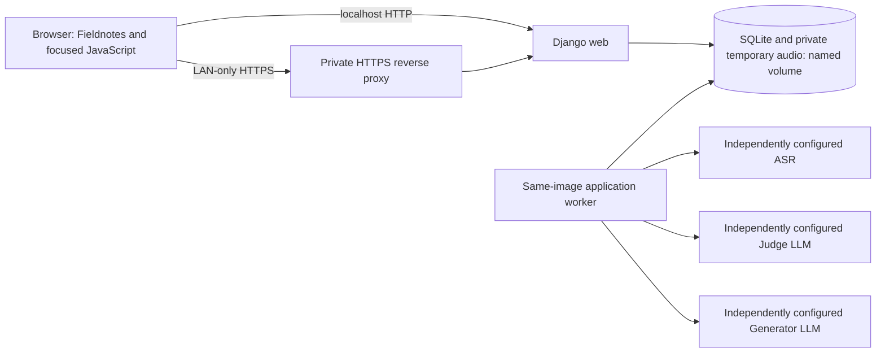

# Decide the Application, Persistence, and Compose Boundaries

Id: 10
Parent: [Vocab-Learn Browser V1 Decision Map](../map.md)
Type: grilling
Labels: wayfinder:grilling
Mode: HITL
Status: resolved
Assignee: /root
Blocked by: 07, 08, 09, 18

## Question

Which minimum technical design fully supports the settled workflows on Python 3.11 for a small group with audio uploads and persistent review progress? Compare only material alternatives, favor installed dependencies and platform features, and settle backend, frontend, database, and container boundaries without introducing queues or service decomposition for unrequested scale.

Define account isolation, sessions and authorization, server control of answers before reveal, atomic attempt/progress updates and duplicate-request handling, time zones and clock sources, credential injection, and temporary audio/retention policy. Do not assume permanent recording storage. Code identifiers, comments, documentation, and all system UI/messages use English; V1 needs no localization framework.

Incorporate the two concrete card sources and their chosen learning units, source edits versus generated-example revisions, and a separately identifiable LLM example-generation task. Do not turn the vocabulary extension into a general plugin framework or select a provider gateway that the user deferred.

The content decisions are now settled in the [Vocabulary lifecycle](15-vocabulary-example-lifecycle.md). Implement source import transactions separately from generation outcomes; retain ready/pending/error source states, locked example/direction choices, scored-only slot advancement, and stale-result rejection without assuming a particular worker design. Select the smallest execution/recovery path that preserves durable replacement intent, fallback to the prior pair, and unmodified shared FSRS progress. LiteLLM SDK/proxy is deferred by the user's choice.

The server must commit an immutable submission before releasing its reference answer, with ASR/LLM work outside that release path. Decide the smallest processing/interruption design that preserves same-recording retries and applies a result only once. This requirement does not itself select a queue, streaming transport, or background-worker architecture.

Preserve the assessed question/reference and measured response budget consistently with its result. Commit progress and next due time together before returning the final feedback, so Next review cannot display a schedule that was not saved. Render question/explanation only through the verified safe Markdown path; escape the plaintext reference, transcript, and AI feedback. Arbitrary user-supplied HTML must never become executable markup.

The account/deck contract requires atomic CSV validation/import, ownership-scoped archives/history, and canonical learning identity for edit/reset and duplicate detection. Preserve authored Markdown and meaningful indentation. Treat parser/profile changes as migrations; they must not silently reset progress or create duplicates. Stale in-flight grading cannot overwrite a content revision's fresh progress.

Keep the full returned FSRS memory/state and the application collection/streak separate. Validate due eligibility and protect against applying duplicate or stale attempts to a newer card schedule. Scheduler fuzzing means completed results must be reused, not recomputed on retries. Use recorded submission/action time in UTC for scheduling, independently of the later model completion time.

Describe Compose services, named volumes, database migration, and a verifiable backup/restore path on another machine. Specify microphone/HTTPS boundaries for localhost and access by acquaintances. Available development tools do not establish that images or deployed behavior are tested. Make architecture decisions only; do not implement or deploy. Record an ADR only when the domain-modeling criteria for a consequential trade-off apply.

## Comments

2026-10-31: Provider contracts and [Python 3.11 deployment evidence](18-python311-deployment-evidence.md) are resolved. The core stack below has been accepted; access/retention preferences still prevent completing the architecture decision.

### Confirmed application stack

- Django 5.2 LTS on the requested Python 3.11 environment, using its auth, database sessions, CSRF, trusted-staff admin, ORM, and migrations. Learners receive ownership-scoped custom pages, not the admin interface.
- Server-rendered templates with the selected Fieldnotes design and focused JavaScript for MediaRecorder, submissions, status updates, and card transitions. Reuse CSS/layout vocabulary without a separate SPA/build stack. Gunicorn serves the application; WhiteNoise serves packaged static assets for both localhost and reverse-proxied use.
- SQLite in a local named data volume for this small single-host deployment, initially using rollback-journal mode. Use brief write transactions and expected-revision conditional updates, never ineffective select-for-update assumptions. Do not enable WAL on an unverified affected runtime. The user accepted this database choice.
- One application image has separate web and worker commands/services. The bounded worker processes persisted assessment/preparation intent outside HTTP requests and database locks, with reviewed attempts taking priority over bulk preparation. Claims, progress, due times, direction slots, and stale-result rejection remain application-owned. No Redis/Celery or generic task framework is established as necessary.
- The user selected LAN-only private HTTPS for remote access, with no public ingress. Use a LAN HTTPS reverse-proxy entry with certificates trusted by the target client browsers; localhost remains a development origin. The certificate/DNS setup must be concrete in the final deployment contract. LAN ingress does not change the configured external provider connections.
- Persist SQLite and required private temporary audio in named volumes; retain secrets in server configuration, outside version control. Plan a simple maintenance-window export by stopping every writer, exporting a consistent data set, and testing restoration into a fresh volume with the same application/migrations. Implementation may add an online snapshot only when required, not a blind tar of live SQLite files.

### Remaining user preferences

SQLite and LAN-only private HTTPS are confirmed. Still confirm the lifetime of original/normalized audio for retry and retained text. The proposed audio default is deletion after a successful assessment, with failed/interrupted audio retained at most 24 hours; durable transcripts, results, and learning history remain. An expired recording becomes an explicit unassessed/retry-expired condition rather than a wrong answer.

Audio expiry prevents a new ASR call when no transcript exists; a successful frozen transcript can still support judge-only retry without retaining the recording. Do not make storage expiry a hidden wrong-answer event or overwrite an older submission with a new recording.

Sent three questions for the candidate: SQLite versus PostgreSQL, public-domain versus private-network HTTPS, and successful-audio deletion with a 24-hour failed-audio window versus no cross-session failed-audio retention. These are product/deployment preferences awaiting the user, not completed deployment authorization.

The diagram describes the accepted SQLite application stack and LAN-only HTTPS access. No container or application process has been created from this proposal.

The user explicitly amended model configuration to separate Judge and Generator with identical MiniMax defaults, and accepted the remaining visible architecture recommendations: Django 5.2 LTS, Fieldnotes server templates/focused JavaScript, SQLite/local volume, and same-image web/worker processes. These stack choices are confirmed. They could not see the interactive questions, so do not infer public/private HTTPS or audio-retention consent from the unseen options. Restate only those two remaining preferences in ordinary response text.

The user then chose LAN-only private HTTPS for Q1. For Q2 they asked what transcript means, without accepting the retention policy. Explained that it is ASR-recognized response text (shown as Your response), distinct from the audio file: for example, the recorded utterance misunderstanding may yield the text misunderstanding. Restate the proposed audio/text retention policy in normal response text and await acceptance. This clarification is not a scored product interaction or consent to an unseen option.

After the explanation, the user explicitly accepted Q2. Audio retention is now confirmed: delete successful audio, retain failed/interrupted audio for at most 24 hours, and retain recognized text, grades, and learning history. This completes the user-preference branches. The concrete execution, certificate, storage, and recovery details below implement those choices.

## Answer

Resolved on 2026-10-31 through acceptance of the Django/SQLite/same-image-worker stack, explicit LAN-only HTTPS selection, independent Judge/Generator correction, and audio-retention acceptance after the transcript explanation. This is the V1 architecture contract, not a running application.

### Application shape

Use Django 5.2 LTS with a maintained Python 3.11 runtime. The requested Conda environment remains the development environment; the deployment image has its own reproducible dependency/runtime specification. Use Django auth/password hashing, database sessions, CSRF middleware, trusted-staff administration, ORM, and migrations. Deployer-managed account creation/reset remains the chosen workflow. Private learner pages are custom ownership-scoped views, distinct from trusted administration.

Render pages with Django templates and carry the selected Fieldnotes typography, spacing, colors, and layout across learning, library/import, login, and statistics. Focused browser JavaScript handles MediaRecorder, immutable submission, status polling, card states, and accessible focus. Gunicorn serves the web process; WhiteNoise serves packaged public CSS/JavaScript after collectstatic. No separate SPA/build pipeline is required. Private recordings and other user data are never WhiteNoise/static assets.

Use the existing HTTPX, markdown-it-py, and pinned FSRS integration for their settled roles, plus FFmpeg in the application image. ASR, Judge, and Generator have independent server configurations under the [provider contract](09-provider-configuration.md), even when all defaults use MiniMax. Reuse the chat implementation without sharing model/key settings. No LiteLLM, Redis, Celery, or general plugin system is part of V1.

### Compose processes and persistent data

One application image runs two commands/services: web and a Django management-command worker. A Caddy service supplies private LAN HTTPS. The worker processes persisted assessment and example-preparation intent, including work left when a browser disconnects; it is not an in-memory callback attached to a web request. Use a small initial concurrency limit of two with queued assessments prioritized over bulk preparation. Do not promise preemption of an already running provider call or a measured latency bound.

Keep four named volumes with clear purposes:

| Volume | Contents and lifetime |
| --- | --- |
| `app_data` | SQLite database, sessions, source revisions, progress, review history, example revisions, and durable processing intent |
| `audio_tmp` | Private original and normalized recordings, governed by the accepted TTL rather than long-term archival |
| `caddy_data` | Caddy certificates, internal CA identity, and private keys |
| `caddy_config` | Caddy's persisted configuration state |

Mount database/audio only into the processes that need them and use compatible application UID/GID permissions. Caddy does not serve those volumes. Keep source, migrations, and packaged static assets in the versioned application image. Secrets belong in deployer environment/configuration outside version control; do not log them or put them in client payloads.

### Private LAN HTTPS

Use Caddy internal issuance with a deployment-configurable hostname, initially `vocab.home.arpa`. Each client resolves that name to the server LAN IP through local DNS or a hosts entry and visits the same hostname used by the certificate. This requires no public application domain or public ACME ingress. Every supported Chrome/Edge client must trust the exported public root certificate through its applicable trust store. Export only root.crt to clients; CA private keys remain protected server data.

Persist the CA volume across restart/migration so clients can retain trust. A replacement CA requires reprovisioning that trust. This is a one-time deployment setup per client, not a certificate-warning bypass or a special browser flag. [Private HTTPS evidence](../../../research/v1-python311-deployment.md).

Publish HTTPS on the configured host LAN IP, initially TCP 443, and keep web/worker ports unpublished on the Compose network. Docker host-IP publication enforces that binding; the host LAN address is not a container interface to put in Caddy's bind directive. Do not assume public port forwarding. Any optional redirect/HTTP3 publication must use the same LAN restriction; neither is required for the initial HTTPS URL. Host/router access rules must preserve the selected LAN-only ingress.

Configure Django allowed hosts and trusted CSRF origins for the chosen HTTPS origin, secure session/CSRF cookies, and correct proxy HTTPS handling. Trust proxy headers only through the controlled proxy route. The localhost development origin can remain HTTP with a separate development configuration. LAN-only browser access does not disable the server's required outbound calls to the configured providers.

### Short writes and ownership

Use SQLite on the single host's local volume in initial rollback-journal mode. Do not enable WAL without verifying a patched runtime and the intended topology. SQLite has one writer; Django's select-for-update does not provide row locks here. Use short explicit atomic transactions, IMMEDIATE acquisition where configured, expected-revision conditional updates, uniqueness constraints, and matched-row checks. Do not wrap whole requests/provider waits in write transactions.

Every read/mutation/review/import/status/retry/archive path filters ownership through the authenticated user, including metrics and referenced deck/card identities. Framework authentication alone is not object-level authorization. A conflicting or stale completion must reread/reject safely, not apply itself to newer content/progress.

CSV source validation and creation are one database transaction, with no model calls under it. Initial preparation runs after sources persist, as defined in the [lifecycle](15-vocabulary-example-lifecycle.md). Valid imports remain saved if generation later fails. Preserve authored Markdown and apply the proven canonical identity/profile rules for duplicate detection and edit resets. Migrate parser/schema changes deliberately.

### Durable review and generation workflow

Persist the chosen question, direction, source/example/reference revision, and expected progress version before display; the front response omits reference data that would reveal a Production answer. Commit a complete fixed recording and submission metadata before returning the back/reference. Audio conversion, ASR, judging, and generation run outside that release path. Stage private file writes before the short database commit and clean orphan files after interrupted/failed commits; do not pretend a filesystem write and database commit form one atomic operation.

Use persisted processing states and bounded claims/leases on the concrete attempt/preparation records. The worker briefly claims, commits, calls providers outside locks, then briefly checks its claim/current revisions and stores the result. Pending work not started can resume after restart. An expired claim whose upstream completion is uncertain becomes a visible retryable failure rather than blindly repeating paid work. User Retry reuses fixed input and a successful cached transcript. No broker or generic task registry is needed to express these two concrete workflows.

Initial source creation includes durable preparation intent in the same transaction, and successful E commits include durable replacement intent. Use the [generation recovery contract](15-vocabulary-example-lifecycle.md): its initial whole-execution deadline is 300 seconds including unclaimed work, separate from the 120-second Generator call limit. Web status routes can expose expiry/retry even without the worker. Save first-pair readiness or a candidate result atomically/idempotently before acknowledgment; replay does not create another result, and old source revisions cannot become Ready.

Coordinate active-pair selection/activation with the presentation's retained cue lock. A candidate arriving after a valid old pair is locked stays pending; neither its storage nor its metadata revision can invalidate the learner's still-valid response. Judgment uses that frozen presentation's example identity plus the source/progress/claim checks. Authorized activation alone preserves scored/progress fields while changing the active example/rotation intent at the permitted boundary.

Commit the scored outcome, full FSRS state/log, effective due time, collection/streak, one direction-slot advancement, and example-replacement intent together once. Compute a candidate from the frozen state and reuse it on a database-only retry; do not repeat provider calls or reroll an already committed fuzzed interval. An idempotency key/unique attempt identity and expected progress revision prevent double-clicks, two tabs, and duplicate job delivery from scoring twice. Old source/example/claim results cannot overwrite a reset or archived card. Preserve previous completed history; unapplied stale work is explicitly unassessed rather than a new mastery event.

Keep polling/status reads lightweight. A completed attempt returns its stored result on repeated requests; a pending/failed attempt shows its saved stage and permitted recovery. [Attempt completion and interruption](19-attempt-completion-and-interruption.md) makes assessed and closed-unassessed competing atomic terminal outcomes: the first commit wins, and a closed attempt cannot be retried or updated by late work. Expire unfinished executions after the configured whole-execution budget (initially 300 seconds), including unclaimed work, through web/status routes as well as worker checks. Repeated or late work must match a current, unexpired execution claim. The UI retains the agreed Next-card restriction until a server-confirmed assessment or unassessed exit. Generation activation and fallback obey the lifecycle.

### Worker timeout and capacity recovery

Use real whole-execution deadlines, not only HTTPX connect/read/write/pool timeouts or waiting on a Future. Fencing a stale result protects data but does not terminate a blocked callable, reap a conversion child, close transport resources or return permits. Every execution path must implement bounded cleanup/recovery; initially allow `WORKER_CLEANUP_GRACE_SECONDS=10` after the deadline. This is an engineering budget requiring implementation evidence.

The implementation may use cancellable transport I/O, controlled child termination/reaping, or bounded automatic worker replacement. A timeout around a synchronous thread does not kill it. Do not satisfy recovery by spawning unbounded new pools or requiring a manual restart. Preserve bounded capacity and late-result fencing, and prove a queued healthy job completes after all configured slots are faulted. This applies to conversion, ASR, Judge and Generator; it does not promise cancellation of the remote provider's computation or billing. [Verified runtime distinctions](../../../research/v1-review-round2-worker-evidence.md).

### Time and interruption

Store timezone-aware UTC server submission/action timestamps for scheduling and report dates, with the agreed default display timezone Asia/Shanghai. Use the recorded submission time rather than later model completion. The monotonic browser display-to-Stop duration is a separate field and excludes permission/upload/provider waits under the [grading contract](16-vocabulary-grading.md). Validate timing as usable/finite and retain its budget; do not infer it from audio length.

Cancel on the same presentation preserves its elapsed thinking/recording time. A reload retains that presentation's valid elapsed clock, cue/direction, and permission exclusions. If its clock cannot be reliably restored, explicitly mark it interrupted/unscored and offer Restart question with the same retained cue/direction; only an explicit new presentation starts a fresh clock. A committed submission always resumes its frozen readonly/processing state, never a replacement recording. [Completion/interruption semantics](19-attempt-completion-and-interruption.md) supersedes the earlier permissive refresh wording and defines pending-permission cancellation and late-stream cleanup. V1 does not claim tamper-proof client timing.

### Accepted recording/text retention

Delete original and normalized audio after a successful assessment commits, not merely after an ASR response. Persist the successful transcript before relying on it for recovery. Keep failed/interrupted submitted audio for at most 24 hours from its original submission; Retry, restart, and restore never extend that expiry. After expiry no new ASR request can use it. A durable transcript can support judge-only retry while the attempt is nonterminal. Otherwise show the expired/missing-recording condition and permit an unassessed exit/new eligible review; do not replace the old submission or score storage failure as wrong. A terminal unassessed exit cannot later be revived by cached text.

Retain readonly ASR text, results, timing, source/example snapshots, and learning history according to the accepted account/archive contract. Log only necessary operational stage/trace metadata, not recording bodies or secret values. Cancelled browser-only audio is discarded rather than uploaded as a submission.

Enforce expiry in access/processing checks and run physical cleanup periodically and at startup. Physical deletion on a powered-off server occurs on restart; explain that operational limitation rather than promising execution while the server is down. Keep `audio_tmp` out of long-term backups so an archive cannot silently defeat the temporary-recording policy. Persistent TLS/CA storage has a separate lifecycle and does not extend audio retention.

### Migration, backup, and restore

Run versioned Django migrations as a controlled one-off command before starting web/worker against a new schema, using the same application image. Do not race migrations in every container startup. Use a simple maintenance-window cold backup for V1: stop every writer and the relevant proxy state changes, export `app_data` and protected Caddy volumes consistently, and store a manifest with application/schema/renderer/FSRS versions. Transfer required deployer secrets separately under operator control. A named volume alone is not a backup.

Every restore acceptance case must consume an artifact produced by the exact backup command or versioned operator steps delivered with V1, including its audio exclusions and manifest. Record that procedure version with the evidence. A special test-only snapshot/copy does not certify the deployer's backup workflow. Cold backup is the selected requirement; no online-backup feature is added by this constraint.

Exclude temporary audio. On restore into fresh named volumes, use the compatible image/configuration, verify database integrity and sample ownership/card/history/progress records, apply deliberate migrations if needed, then start processes. Missing audio is an explicit recoverable/unassessed condition; valid completed results and transcripts remain. Update local name resolution/LAN binding for a changed server address while retaining the CA identity. Prove private HTTPS/microphone access and queue/history continuity on the restored machine before claiming migration success.

### Evidence and implementation limits

[Deployment research](../../../research/v1-python311-deployment.md) supplies primary-source compatibility, static-serving, SQLite, private-TLS, and backup facts. The architecture requires file-backed concurrent-write/idempotency tests, worker interruption/recovery tests, audio-expiry tests, fresh-volume restore, and actual Chrome/Edge certificate/microphone/conversion checks. Fake provider tests remain separate from live account/language-quality verification.

No framework was installed, application implemented, container run, certificate generated/imported, port exposed, backup restored, or paid model called by this decision. Those are implementation checks, not undisclosed completed work. The next ticket consolidates acceptance and handoff without reopening already settled product choices.
