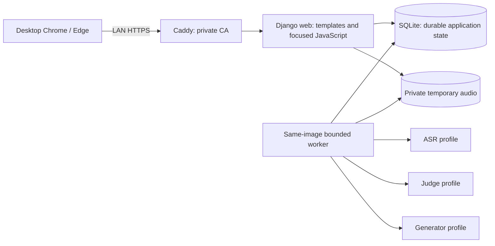
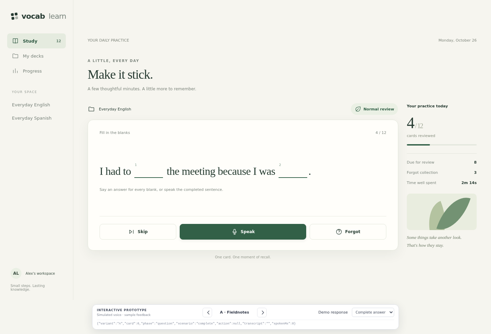

# Vocab-Learn V1 Development Specification

Status: canonical development specification; V1 implementation is available and user acceptance is pending. See the [implementation acceptance record](../implementation/v1-acceptance.md) and [operations guide](../operations.md) for runtime evidence and setup.
Baseline: reviewer-approved `reviewer-follow-up-2`, as confirmed by the user.
Version: 1.0.

This document consolidates the approved V1 requirements, technical boundaries, implementation sequence and 52 acceptance cases. Use it as the primary contract for development and future rule changes. The [domain glossary](../../CONTEXT.md) supplies terminology; the [decision map](../planning/v1/map.md) and its resolved tickets preserve the reasoning and review history.

The consolidation introduces no new product decisions. Historical proposals and superseded wording in the decision archive are not current requirements. Maintain subsequent agreed changes here and update their affected acceptance cases, retaining case IDs. Research and prototype results have only their recorded scope; planning approval is not application acceptance.

## Contents

- [Status and scope](#status-and-scope)
- [Domain and stored state](#domain-and-stored-state)
- [Authoring, import, and editing](#authoring-import-and-editing)
- [Review interaction](#review-interaction)
- [Grading and timing](#grading-and-timing)
- [Scheduling and continuous practice](#scheduling-and-continuous-practice)
- [Vocabulary examples and directions](#vocabulary-examples-and-directions)
- [Provider interfaces and configuration](#provider-interfaces-and-configuration)
- [Execution, concurrency, and recovery](#execution-concurrency-and-recovery)
- [Application and deployment](#application-and-deployment)
- [Statistics and visual design](#statistics-and-visual-design)
- [Implementation sequence](#implementation-sequence)
- [Acceptance specification](#acceptance-specification)
- [Verification and handoff](#verification-and-handoff)
- [Decision traceability](#decision-traceability)

## Status and scope

Build a browser application for the owner and a few acquaintances, with independent accounts and private decks. Learning combines flash cards, spoken answers, AI assessment and spaced repetition. Desktop Chrome and Edge are the required browsers. LAN access uses private HTTPS; localhost HTTP remains a development option.

All system UI, navigation, validation, feedback, error messages, code identifiers, comments and project documentation use English. There is no UI-language selector or localization framework. Learning content can be multilingual.

V1 includes two card sources:

| Source | Authored fields | Review goal |
| --- | --- | --- |
| Generic Card | `question`, `answer`, `explanation` | Recall the authored reference content/expression. Zero or more cloze blanks; one spoken response covers the whole card. |
| Vocabulary Card | `word`, `explanation`, `native_language`, `target_language` | AI-generated Recognition and Production contexts review one shared learning unit. |

Generic content is language-independent. Vocabulary requires explicit language choices at manual entry or CSV import, without language inference:

| Field | Allowed values |
| --- | --- |
| `target_language` | `English`, `Spanish` |
| `native_language` | `Chinese`, `Spanish` |

The languages must differ, giving English/Chinese, English/Spanish and Spanish/Chinese. These are learning-language fields, independent of the English-only interface.

V1 excludes native mobile apps, full mobile/Safari support, public ingress, self-registration/invitations/email recovery, payments/social features/shared-deck marketplace, user-managed API keys/provider settings, additional learning modes or a general plugin framework. Same-language Vocabulary training, LiteLLM SDK/proxy, automatic provider/model fallback, scheduler optimization/personalization and online backup are also outside the selected scope. An ASR adapter's declared language capability still requires live validation; unrestricted Generic authoring does not promise universal default-ASR coverage.

## Domain and stored state

The following are logical responsibilities and invariants, not a prescribed ORM class hierarchy or application URL schema.

| Record or concept | Required identity and durable information |
| --- | --- |
| Account / Private Deck | Framework user identity; explicit ownership and archive status. Each card belongs to a private deck. |
| Card / Source Revision | Stable card identity and type, original authored fields, learning-content revision and archive status. Authored identity is distinct from generated content. |
| Card Progress | One account/card learning record: logical progress version, complete FSRS state, effective due time, Normal/Forgot collection and qualifying Forgot streak. |
| Vocabulary direction state | One retained two-slot block, current slot/direction and cue lock per Vocabulary Card. Incomplete recall retains the direction; Forgot retains it through graduation. Both directions share Card Progress. |
| Example Revision | Saved target/native sentences and highlight identities, source revision and generation provenance, including prompt version. Distinguish active pair, pending candidate and rotation authorization. No generated definition or native reference-answer paragraph. |
| Presentation | Fixed question, review goal/direction, source/example/reference identity, expected progress version, ordered answer units and response-clock state; one accepted front action. |
| Attempt / Assessment Execution | Immutable spoken submission or direct action; original receipt/expiry, timing and reference snapshots; processing stage, execution claim/deadline, safe error metadata, transcript/provenance and stored terminal result. Explicit Retry creates another execution, not another answer. |
| Generation intent / execution | Durable initial/replacement request, source revision, authorizing rotation identity when applicable, request/start times, claim-time execution deadline, current claim, task-profile provenance and at most one accepted result per intent. |
| Scored Review | Immutable assessed content/direction/reference, duration/budget, A-E feedback, server review time, FSRS log and committed next due time. |
| Temporary Deferral | A separate 30-minute pause in card availability after Skip or confirmed unassessed exit; it preserves the saved learning schedule and history. |

Distinct valid cards keep independent progress even when their word text matches. Different senses, contexts or decks can be independent. Generated examples, directions and individual blanks are not independently scheduled cards. Example replacement alone never creates fresh progress.

Retain the exact assessed source/question/example/reference, direction, unit identities, timing and result with history. Preserve non-secret provider/model/profile provenance; do not store credential values in execution snapshots. Changes to models, prompts or source content cannot retroactively regrade or regenerate completed snapshots.

The deployer creates accounts and resets passwords. Learners log in with username/password and can log out. Use Django's authentication, password hashing, database sessions, CSRF and password-reset/session behavior. Trusted-staff administration is separate from custom learner pages. Enforce ownership on every learner list, detail, mutation, import, archive, review, status, retry and statistics path, including referenced object IDs.

## Authoring, import, and editing

### Manual entry and CSV

Support private-deck management, manual creation/editing and CSV import into a selected deck. Both entry routes use the same required-field, language, identity and rendering rules. Words, phrases and short sentences are valid answer/target content; do not impose a word-only restriction.

| Import type | Exact set of unique headers |
| --- | --- |
| Generic | `question,answer,explanation` |
| Vocabulary | `word,explanation,native_language,target_language` |

Header order may vary. Every required field is nonblank. Accept UTF-8 with an optional BOM, standard CSV quoting, embedded commas/quotes and quoted multiline Markdown. Preserve original source and meaningful indentation when checking emptiness. The two schemas remain distinct; examples and generated references are not extra Vocabulary CSV columns.

Validate the complete batch before committing any source writes. Invalid headers, field/record shape, required values or language combinations fail the entire batch with English, record-specific errors. Existing data stays unchanged. A failed batch leaves no new sources, executable generation intent or provider call. Use a database transaction for source creation; never make model calls while holding it.

Within the selected deck, skip duplicates against the incoming batch and existing active/archived cards:

- Generic identity uses canonical question learning content/blank structure plus the plaintext reference answer.
- Vocabulary identity uses the exact target expression, canonical authored explanation and both languages.

Different decks have independent identities. Skip without overwriting explanations or restoring archives. Report created/skipped counts and, for Vocabulary, preparation status separately. A later generation failure does not roll back a valid source import.

Use the [Generic CSV sample](../examples/cloze-cards.csv), [Vocabulary CSV sample](../examples/vocabulary-cards.csv) and [authoring notes](../examples/README.md). These are source examples, not a running importer.

### Safe Markdown and cloze units

Store original Markdown for Generic questions and both card types' explanations. Render through the same configured `markdown-it-py==4.0.0` path wherever displayed. Answer and word remain plaintext, escaped for display; generated examples, transcript and model feedback are also escaped text.

Support CommonMark bold/emphasis, paragraphs, headings, lists, quotes, code and safe links. Underline is the narrow extension `<u>text</u>`: exact lowercase, attribute-free, paired within one inline block and properly nested. `__text__` means bold.

Expand `{{blank}}` only in parsed Generic question prose, assigning actual blanks ordered identities 1..N. Formatting may wrap a blank, including `**{{blank}}**` and `<u>{{blank}}</u>`. A zero-blank question has one whole-answer unit. One reference answer covers the whole card; authors must make multi-blank association clear. No maintained accepted-variants list or per-blank progress is required.

Escaped markers, code spans/fences, Markdown link destinations/autolinks and HTML token contents stay literal. Bare unlinked URLs are prose; escape their marker or use code/autolink syntax to keep it literal. Explanation never expands blanks.

Escape arbitrary authored HTML. Emit only application-controlled blank markup and validated underline. Unsafe/custom/protocol-relative links are inactive; images display alt text without remote loading. An authored counterfeit cloze span cannot create a visible/judged blank.

Use one parsed representation for safe HTML, visible question text, blank identities, timing counts and canonical learning identity. Give the Judge visible text with explicit numbered units, not formatting HTML or an independent regex count. Preserve meaningful block structure, code kind/content and link destinations in the semantic comparison. A default HTML-enabled renderer is not interchangeable with this configured path.

### Edits and archives

| Edit or action | Progress and content effect |
| --- | --- |
| Generic question learning content, blank structure/order, or answer changes | New learning revision, fresh unseen Normal progress; invalidate old work and retain completed history. |
| Generic explanation or deck name changes | Preserve progress. |
| Vocabulary word, explanation learning text, or either language changes | New learning revision, fresh unseen Normal progress, discard obsolete pair/rotation/cue choices and prepare a new pair; retain completed history. Explain the reset before save. |
| Proven inline presentation-only strong/emphasis/validated-underline wrapper changes | Preserve progress when canonical learning content and blank/answer identity are unchanged. Vocabulary explanation wrappers also preserve existing examples. |
| Model/prompt/profile changes | Affect later dispatch only; do not rewrite accepted examples or completed results. |
| Archive / restore | Retain source, progress, pair, direction and history. Exclude archives from study; restore at the retained due time, including overdue eligibility. |

Formatting-only preservation is the documented implementation default adopted during planning; it is not a general semantic-diff model. Do not infer equivalence by stripping all Markdown/HTML. Parser/profile upgrades require a deliberate identity migration.

Archiving a deck excludes its cards while preserving individual card archive flags. Archiving invalidates/closes active work; restoring cannot revive pre-archive executions. Historical statistics retain valid completed reviews. Imports never restore an archive implicitly.

## Review interaction

### Front, recording, and reveal

A ready eligible presentation shows its fixed question and three actions: **Skip**, **Speak**, **Forgot**. The server must not deliver the answer/reference in the front response, especially through Vocabulary Production titles, explanation or hidden counterpart payloads.

| Action or event | Required behavior |
| --- | --- |
| Skip | Reveal immediately, show Skipped, no A-E grade, ASR/Judge call or new generation trigger; retain progress/direction/cue and temporarily defer this card for 30 minutes. |
| Forgot | Reveal immediately and commit A without ASR/Judge; apply scheduling/collection/slot effects once. |
| Speak | Click to start one recording for the entire card. Do not reveal the reference yet. |
| Cancel before submission | Discard browser-only audio and return to the question; permit rerecording without reveal or clock reset. |
| Stop & check | Stop recording, collect the final MediaRecorder data and durably commit the complete fixed submission before releasing the reference. |
| Back while checking | Show answer/explanation immediately after that commit while conversion/ASR/Judge continue. Display readonly **Your response** when available. |
| Assessment completed | Show **Your recall this time**, grade, English reason and saved **Next review**; enable Next card. |
| Technical failure / explicit unassessed exit | Show useful recovery. Retry only the same fixed input while nonterminal, or obtain server-confirmed Proceed unassessed before continuing. |

Only a spoken submission can produce B-E. Typed transcript edits cannot submit or improve a score. Once the reference is revealed, no replacement recording can overwrite that attempt. A later eligible review after Skip/closed-unassessed is a new presentation/attempt with its own recording, retaining the unresolved cue/direction where required.

Healthy checking keeps Next card disabled. A processing error, status-communication error or execution deadline exposes recovery. The server must confirm assessed or closed-unassessed before the UI claims that terminal outcome. Disconnection, tab close or fetch cancellation alone does not close server work. An unconfirmed/offline exit shows reconnect/status recovery rather than an invented no-score success.

### Permission and clock recovery

Offer Cancel immediately while `getUserMedia` is pending; do not wait for its promise to settle. Each acquisition has an identity/liveness flag. Cancel/navigation invalidates it and ends the permission-blocked interval. A late obsolete grant stops every returned track without recording; a late rejection cannot overwrite newer UI. Clear owned timers/streams. Logical cancellation does not dismiss the native prompt or assume an undocumented AbortSignal contract.

Refresh/reconnect of an unsubmitted presentation preserves its question, direction, valid elapsed clock and permission exclusions, including the refresh gap. Do not subtract unrelated `performance.now` origins across navigations. If clock or permission-wait history cannot be reliably restored, mark the presentation explicitly interrupted/unscored and offer Restart question or Skip/Forgot with the same retained cue/direction. Only explicit restart creates a new presentation clock; it supplies no score or slot advancement.

A submitted attempt resumes frozen duration and readonly/processing state. Restart question cannot replace submitted audio. V1 does not claim tamper-proof client timing.

## Grading and timing

### Goal-aware correctness

| Task | Complete | Partial | Incorrect |
| --- | --- | --- | --- |
| Generic | Authored reference target/content under the established equivalence rule, including appropriate forms/spelling and natural full-sentence delivery | Suitable synonym/paraphrase conveys meaning but does not recall the benchmark target/content | Wrong or unanswered required component |
| Vocabulary Recognition | Complete in-context meaning in the native language; equivalent word, phrase or explanatory sentence is valid | Relevant meaning is materially incomplete/imprecise | Wrong sense, consequence rather than meaning, or failure to answer the task |
| Vocabulary Production | Authored target expression or genuinely equivalent spelling/contextually appropriate form | Contextually suitable substitute without target retrieval | Missing/wrong expression or unsuitable sense |

Generic's `call off` reference versus `cancel` response is partial/C at any speed: this is expression recall, even though cancel forms a sensible sentence. Make that goal explicit in the Judge input. Do not turn the rule into literal whole-transcript matching or silently switch this fixture to semantic-only D/E.

Vocabulary Recognition uses the authored explanation and visible target-language context as semantic authority. A conventional equivalent word or short phrase is complete: its lexical meaning already carries its defining properties. For liquid absorb, 吸收 is complete without explicitly adding that the liquid is retained; 探险 for adventure and 异常/不正常 for abnormal are also complete in an appropriate context. Do not downgrade these answers for being shorter than a definition. A genuinely broader meaning remains partial: 改时间 for postpone omits the later-time distinction, whereas 推迟 is complete. Neither direction requires translating the full sentence. Production still treats a suitable different expression as partial. A synonyms list is supporting context, not automatic acceptance. Merely mentioning the target in a contradictory response is insufficient. Answer-language expectations follow the task; borrowed expressions and ordinary forms are judged contextually, not through a simplistic language detector. An intelligible wrong answer is not excused as hypothetical ASR error merely because it is wrong.

Normalize Judge output to one identity, outcome (`complete` / `partial` / `incorrect`) and English reason per expected unit. Generic cloze uses each actual blank; zero-blank Generic and Vocabulary use one whole-answer/meaning unit. Explicit inability to assess is separate from semantic outcomes.

Validate expected identities/counts, enums and usable content before applying any result. A valid output saying the learner omitted an answer gives B; the provider omitting a required unit gives **Not assessed**. Empty/unusable ASR text, refusal, invalid output or unresolved ambiguity is technical/unassessed.

### Feedback and application mapping

Use **Your recall this time**. These labels describe this attempt, not lifetime mastery.

| Grade | English label | Rule | FSRS rating |
| --- | --- | --- | --- |
| A | Needs a refresh | Explicit Forgot | Again |
| B | Needs practice | Any incorrect/unanswered unit in a valid complete judgment | Again |
| C | Partial recall | No incorrect unit, but at least one partial unit | Again |
| D | Correct recall | All units complete; response duration above T | Good |
| E | Quick recall | All units complete; response duration at/below T | Easy |

The application enforces B before C and computes D/E from saved timing. Speed cannot upgrade B/C. The model never selects A-E, invents duration, changes actions, chooses a schedule or sets Next review. Skip/Cancel/Not assessed are outside A-E; technical failure cannot become B. Only D/E are complete successes.

### Two time measures

Recall duration runs from the actual ready question being fully displayed to browser Stop & check. Include thinking, recording and cancelled/rerecorded time. Subtract microphone-permission blocking. Exclude generation wait, upload, conversion, ASR, Judge and Retry waits. Freeze duration and budget with the submission. Invalid/missing timing is technical, not evidence for a lower grade.

The initial budget in seconds is:

```text
T = max(12, ceil(5 * N + Q / 20 + R / 5))
```

N is the actual cloze count, or 1 for a whole-answer task. Q counts non-whitespace Unicode code points in the actual visible question, excluding real blank tokens and Markdown syntax. Vocabulary Q includes its displayed sentence/highlight, excluding the hidden counterpart, phonetics and back explanation. R counts non-whitespace Unicode code points in Generic's answer, Recognition's frozen native highlight or Production's authored target expression. The native highlight estimates the length of a concise meaning response; it is not an exact-match grading reference. Do not time a response against a generated definition paragraph. Existing presentation budgets remain frozen. Exactly T is E; above T is D. This is an initial uncalibrated heuristic, not a retention or cross-language fluency guarantee.

Scheduling has a separate authoritative UTC anchor: server acceptance of the complete immutable submission, or acceptance of the direct Forgot action. Never substitute model completion time. Upload delay may move this anchor without changing recall duration; post-submission processing changes neither. Retry/replay preserve both.

### Next review

Use the committed effective scheduler due timestamp, returned with the saved grade before Next card is enabled. Display **After checking** while pending, **Due now** when already due, otherwise approximate relative units such as `~1 min`, `~1 day`, `~4 days` or `~1 month` (about 30 days onward). Display rounding does not rewrite the timestamp. After Skip/closed-unassessed show **Available again**, using the later of the saved scheduler due and the temporary deferral expiry; explain that the memory schedule is unchanged. A due time means study eligibility, not a notification or a promise to appear while the app is closed.

## Scheduling and continuous practice

### FSRS and business collections

Use `fsrs==6.3.2` with its default parameters, desired retention 0.9, learning steps 1 and 10 minutes, 10-minute relearning, and fuzzing enabled. No optimizer/personalization. Retention is a model setting, not a promised outcome. Map A/B/C to Again, D to Good and E to Easy; Hard is not inferred from slow complete recall.

Normal/Forgot are application collections, separate from FSRS Learning/Review/Relearning. Run FSRS once for each eligible A-E result at its original server review anchor. Preserve the full returned memory/state/log and override only due time where specified:

| Starting collection / result | Resulting collection and streak | Effective next due |
| --- | --- | --- |
| Either, A/B | Forgot, streak 0 | Review anchor + 1 minute |
| Normal, D with the returned FSRS state still Learning | Normal; no Forgot progression | Review anchor + a uniformly selected integer 1, 2 or 3 elapsed days |
| Normal, C/E or D already entering/remaining Review | Normal; no Forgot progression | Unmodified returned FSRS due |
| Forgot, C | Forgot, streak 0 | Review anchor + 1 minute |
| Forgot, first or second qualifying D/E | Forgot, streak +1 | Review anchor + 24 elapsed hours |
| Forgot, third qualifying D/E | Normal, graduation at streak 3 | Unmodified FSRS due from that third review |
| Skip / confirmed unassessed exit | Unchanged; no scheduler call/log | Preserve due; temporarily unavailable for 30 minutes |

The Normal Learning-D exception replaces the default minute-scale Good step only while FSRS still returns Learning after that review. Preserve all returned stability/difficulty/state/step/log fields and change only due; do not force graduation or disable learning steps globally. A D that completes Learning and enters Review retains the native adaptive interval. Select the day offset once per committed review and reuse it across database retries/result replay, saving the same effective due in card memory, attempt and scored history. E remains history-adaptive, including short intervals after prior weak recall. Previously saved due times and history are not recalculated when this policy is deployed.

Graduation preserves stability, difficulty, library state, learning step and last-review time. Missed days do not reset/increment a streak. A delayed eligible review uses its actual review anchor; successes one/two then schedule 24 elapsed hours later, not next midnight. Either Vocabulary direction can start the one streak; that direction remains locked until graduation. A/B starts a fresh streak at zero; Forgot C resets it, while Normal C stays Normal even if FSRS enters Relearning. Graduation establishes recovery in the locked direction, not independent mastery of both directions; later A/B in the other direction enters Forgot again.

Only due eligible cards can receive scored scheduling updates. Prevent early, duplicate or stale work from creating extra successes. Same-day opposite-direction practice is not a shortcut through the spaced streak.

### Continuous practice and temporary deferral

Select only the user's active, Ready cards whose saved due and temporary-deferral expiry both permit practice, in these tiers:

1. Due Forgot.
2. Due previously reviewed Normal.
3. Ready unseen Normal.

Within the two reviewed tiers use earliest due, then stable card ID. Randomly select among eligible unseen cards whenever a new question is needed; no run identity, seed or stored future sequence exists. A future Forgot card does not become eligible because of its collection. Unprepared Vocabulary, archives and temporarily deferred cards are excluded.

Practice has an optional private-deck scope. Entering the same scope resumes its current valid unfinished presentation, including fixed submitted/processing/failed work. The current question, example, direction and clock stay fixed across refresh and return; cards not yet shown have no fixed ordering. Recompute eligibility for each new question so newly Ready cards can join immediately. Concurrent entries in the same scope reuse one current presentation; distinct scopes still use the card's shared progress guards to prevent double scoring.

Skip and server-confirmed unassessed exit temporarily defer the current card for 30 elapsed minutes from that action. Store this availability separately from due/memory/collection/streak/direction/cue; no scheduler call or scored review is added. Replaying the same terminal action does not extend the deferral. A stale source/progress/presentation cannot defer newer progress. A previously accepted assessment can still finish; a committed score clears the old temporary deferral. Source-learning-content resets clear it as well.

The next practice opportunity is the later of the scheduler due and temporary-deferral expiry. Once the 30-minute expiry is reached, an otherwise due card becomes eligible without restarting anything. Entering or leaving Practice does not reset progress, deferrals or balanced review directions.

When nothing is currently selectable, show **Nothing to practice right now** and the next availability when known. Checking again or returning later reevaluates the live queue; no persisted finished state prevents newly Ready or newly due cards from appearing.

Remove the historical StudyRun and run-local Deferral models through a versioned migration: copy each presentation's selected deck scope first, translate recent valid neutral actions into their remaining 30-minute deferral, then detach the run foreign key before removing run tables. Preserve presentation/attempt IDs, frozen snapshots, transcripts, original execution/audio timestamps, card learning state and all scored history. Preserve a cold backup and its matching image before this irreversible migration; rolling back uses that backup. Old run bookmarks/forms redirect to current practice entry points and do not recreate run state.

## Vocabulary examples and directions

### Initial pair and generation quality

Save valid Vocabulary sources before generation. In the same transaction persist initial preparation intent plus a queued execution request without a deadline; the persisted Preparing source may itself be discoverable work. An in-memory post-commit wakeup is only a hint. Failed source batches leave no runnable intent or provider call.

Automatically prepare one aligned pair for each new card. Until a valid first pair exists, show Preparing examples or a visible failure/Retry state; distinguish Queued (waiting for capacity) from Generating (claimed execution), and exclude the source from study and Due now. Keep the source after provider failure. Report import success separately from preparation status. Generation failure is not a scored error or Forgot entry.

Generate from the authored expression, meaning, languages and intended sense. A pair contains:

- One natural target-language sentence and its highlighted target occurrence.
- One aligned native-language sentence and its corresponding highlight.

The Generator wire contract has exactly two strings: `target_sentence` and `native_sentence`, each containing exactly one `<focus>...</focus>` marker pair. The adapter extracts the marked expression and its position, removes the markers and returns four plaintext fields (`target_sentence`, `target_highlight`, `native_sentence`, `native_highlight`) plus required `target_highlight_start` and `native_highlight_start` offsets. Positions count zero-based Unicode code points in the stored plain sentence and locate the trimmed expression while preserving surrounding whitespace. Reject missing, duplicate, empty or reversed markers. Other unmarked occurrences, including the same characters inside computer or 计算机, do not invalidate a marked compute or 计算 occurrence. Render the selected slice at its saved position rather than searching for the first substring. Sentences and highlights are not generated as separate strings, so an absent particle cannot enter the highlight independently. Markers never reach rendered questions or stored examples. Do not generate a translated definition or separate native answer. Keep surrounding vocabulary simple, both sentences about the same situation, and the sense anchored in the source. Target text is the authored expression or a contextually appropriate inflection, retaining lexical identity and word class: adopted is a valid form of adopt; abruptly is a different expression from abrupt. Choose a precise, conventional native equivalent before composing its sentence: for example abnormal → 异常/不正常, absorb → 吸收, adventure → 探险, adopt (a child) → 收养, account (banking) → 账户. Preserve grammatical meaning naturally; absorptive expresses a capacity/property, not the action noun 吸收. Each highlight identifies one unambiguous occurrence of the shortest complete equivalent expression. Exclude independent modifiers, participants, objects, circumstances and explanations; highlight 探险 rather than 刺激的探险. Genuine multiword equivalents remain allowed without a blanket character limit. If source meaning is insufficient, request clarification of the explanation rather than inventing a sense. Phonetics/synonyms are supporting information.

Migration `0008_example_highlight_positions` backfills each existing pair's previous first-match position without modifying its four original strings, source/progress, schedules, direction locks, jobs or frozen question/history snapshots. New Vocabulary snapshots and Judge tasks carry only the visible `highlight_start`; historical snapshots lacking it continue to work.

Generated sentences/spans are plain text with application-controlled highlighting. Validate required fields, spans, language selections, current source and payload structure before accepting. Sense alignment, naturalness and simplicity require quality evidence beyond shape validation.

Recognition shows only the target sentence and asks for the highlighted meaning in the selected native language. Production shows only the native sentence and asks for the target expression. English instructions may say **Say the meaning in Chinese** or **Say the word in English**. Do not expose block-selection machinery. Prevent Production leakage through title, source explanation, counterpart payload or a literal cognate that simply gives away the target; use a natural native paraphrase cue where needed.

The back shows the authored target expression and original authored explanation in both directions, plus the paired examples, transcript, attempt feedback and saved Next review. An English source explanation stays English; no generated native definition is inserted as the teaching explanation. Pair/source must be fixed before question display. Answer reveal never waits for new generation.

An explicit deployer correction may replace old Ready example pairs after a prompt-quality fix. Save a new revision with provenance identifying the corrected pair; preserve FSRS state/due, collection, streak, review counts, source/progress versions, direction position and historical snapshots/grades. Supersede pending rotation intent so an old candidate cannot undo the correction. Unfinished questions, fixed submissions and failed attempts in every scope retain their frozen pair; a corrected cue can take over only before a later presentation after those attempts finish. Correction creates no score and does not replay past judgments or retry not-ready sources. Failed correction leaves the old valid pair available and requires an explicit retry.

### Balanced directions

Persist randomized two-slot blocks, each containing one Recognition and one Production. Lock the selected slot/direction and displayed example before showing a question. Refresh, navigation, Cancel, Skip and technical Retry cannot reroll them.

Consume one slot only when an eligible committed D/E leaves the card in Normal: a Normal D/E or the third consecutive qualifying Forgot D/E. Normal A/B/C and all reviews that leave the card in Forgot retain the current slot, direction and pair. In particular, the first two Forgot D/E results do not unlock the direction, and A/B/C reset the streak without rerolling it. Skip/Not assessed consume none and retain the cue/direction for the next legitimate presentation. Every later review still creates a fresh presentation, response clock and submission at the card's saved eligibility time.

After both slots are completed, shuffle a new block. Balance applies to completed direction stages, not raw attempt counts; a weaker direction can require more attempts. Completing a stage allows progression through the existing randomized sequence, so the next block may begin with the same direction. Example replacement does not reshuffle/restart the block. Direction choice neither creates another due item nor grants early success or an additional scheduling cooldown.

On upgrade, restore a cleared legacy lock for a reviewed Vocabulary card still in Forgot or whose last scored review of its current source is C. Retain the latest scored direction in its existing block and lock the current active pair, including an explicit quality correction. Already locked/shown cues, completed Normal D/E stages, unseen cards and old-source history remain unchanged. Preserve due, memory, collection/streak, progress/review counts, examples, jobs and all historical snapshots; do not replay scoring or generation.

### Retention and rotation

Apply the scored result to shared progress before determining rotation:

| Result and resulting state | Pair policy |
| --- | --- |
| Normal E | Authorize a new whole pair for a later eligible review. |
| Normal C/D | Keep pair. |
| A/B from either collection | Keep pair, enter/remain Forgot, cancel older replacement eligibility. |
| Forgot C | Keep pair; reset shared streak under the scheduling rule. |
| First/second qualifying Forgot D/E | Keep pair frozen, including E. |
| Third qualifying Forgot D, now Normal | Keep pair until a later Normal E. |
| Third qualifying Forgot E, now Normal | Authorize replacement. |
| Skip / Not assessed | No new trigger; retain unresolved pair/direction. |

Do not bank the first two Forgot E results for later D graduation. A qualifying E atomically commits replacement intent and its first queued execution request with the scored result; its deadline begins only when claimed. Each new qualifying E has a fresh rotation identity.

Prepare before needed when practical. Activate only at a safe boundary before a new question, for the current source and still-authorized intent. Activation adds no scored review and preserves logical progress version, FSRS memory/due, collection, streak, direction position and scored statistics. Active example revision and rotation intent may change/be consumed; entire-state equality including intent is not an activation invariant.

Serialize activation with new-presentation selection in short transactions. If a presentation already locked old pair P0, an arriving candidate P1 stays pending: no parent active-pair switch, question/reference/direction/clock change, progress-version bump or false-stale grade. Judge/commit checks use the presentation's frozen example identity, not merely equality with a mutable parent pointer. Actual source/progress/claim guards still apply.

Skip/closed-unassessed retains that unresolved cue lock across later attempts. A later C/D/A/B clears older eligibility; a later qualifying E supersedes it. Discard candidates tied to the older intent rather than silently reassigning them to the new E.

A failed/unready replacement falls back visibly to the old valid pair without a score penalty or due change. Do not block an otherwise due review. That fallback remains fixed through Skip/Retry. Source edits, archive invalidation or superseded triggers prevent stale activation; model/prompt changes do not rewrite accepted pairs.

## Provider interfaces and configuration

### Supported protocol seams

Use direct server-side HTTPX with three caller interfaces: transcribe fixed audio, assess frozen question/reference/transcript, and generate a validated pair. Callers receive normalized results/stage errors. Reuse chat protocol code with independently injected Judge/Generator settings; no gateway or provider class hierarchy is needed.

| Task/protocol | Contract |
| --- | --- |
| Default native MiniMax ASR | Multipart POST `https://api.minimax.cn/v1/speech_to_text`, `asr-1.0`, complete/nonstreaming JSON text, language in the supported header. Do not invent confidence. |
| Replacement OpenAI-compatible ASR | Configured full `/v1/audio/transcriptions` request URL, multipart model/file, nonstreaming JSON text, language form field when known. This is a separate adapter. |
| Judge / Generator | Independently configured nonstreaming Chat Completions, default `https://api.minimax.cn/v1/chat/completions` and `MiniMax-M3.1-Flash`. Distinct task rules and validated outputs. |

A same-protocol replacement must implement the configured request/response subset. Other routes/protocols need an explicit adapter when actually requested. Changing only a URL cannot translate the native ASR header/route into a transcription form contract. Nominal compatibility does not certify every optional field or model.

### Configuration

The deployer supplies settings server-side; learners have no provider/key controls. Full request URLs avoid implicit route rewriting.

| Setting | Initial value or behavior |
| --- | --- |
| `ASR_PROTOCOL` | `minimax`; replacement value `openai` selects the other multipart contract |
| `ASR_ENDPOINT` | `https://api.minimax.cn/v1/speech_to_text` |
| `ASR_MODEL` | `asr-1.0` |
| `JUDGE_ENDPOINT` | `https://api.minimax.cn/v1/chat/completions` |
| `JUDGE_MODEL` | `MiniMax-M3.1-Flash` |
| `GENERATOR_ENDPOINT` | `https://api.minimax.cn/v1/chat/completions` |
| `GENERATOR_MODEL` | `MiniMax-M3.1-Flash` |
| `MINIMAX_API_KEY` | Server environment source for all three default MiniMax task configurations |
| `ASR_API_KEY` | Explicit stage-specific override when supplied |
| `JUDGE_API_KEY` | Explicit judging-only override when supplied |
| `GENERATOR_API_KEY` | Explicit example-generation-only override when supplied |
| `ASR_TIMEOUT_SECONDS` | Initial ASR provider-call deadline 60 seconds, bounded by remaining execution time |
| `ASSESSMENT_TIMEOUT_SECONDS` | Initial whole spoken-attempt execution deadline 300 seconds, including queue waiting |
| `GENERATION_TIMEOUT_SECONDS` | Initial generation execution deadline 300 seconds from worker claim, including call/validation/persistence and excluding queue waiting |
| `WORKER_CLEANUP_GRACE_SECONDS` | Initial bounded local-resource cleanup/recovery budget 10 seconds after execution expiry |
| `JUDGE_TIMEOUT_SECONDS` | Initial Judge provider-call deadline 120 seconds, bounded by remaining execution time |
| `GENERATOR_TIMEOUT_SECONDS` | Initial Generator provider-call deadline 120 seconds, bounded by remaining execution time |
| `JUDGE_MAX_COMPLETION_TOKENS` | Initial judging completion budget 8192, including reasoning |
| `GENERATOR_MAX_COMPLETION_TOKENS` | Initial generation completion budget 8192, including reasoning |

Judge and Generator resolve independently even when defaults match. There is no shared `LLM_MODEL`/`LLM_API_KEY` that changes both tasks. For default MiniMax origin only, `MINIMAX_API_KEY` can supply missing task overrides. Switching origin/protocol requires explicit replacement settings and credentials; never leak this fallback key to another host or through redirected authorization. Browser credentials are not provider credentials.

Validate URL/protocol/model/required credentials at startup without printing secrets or making paid requests. External endpoints use HTTPS; deliberate internal/local HTTP configuration can serve development. Preserve supported MiniMax reasoning behavior; omit unsupported temperature-zero/thinking-disabled overrides and use `max_completion_tokens` with the initial 8192-token budget including reasoning. Do not assume short final JSON means a small generation budget. A replacement needs explicit compatible optional parameters.

### Audio and input language

Capture complete target-browser MediaRecorder blobs, using their actual MIME. Validate real decodability, size and duration; initial ceilings are 500 seconds and 50 MB. Reject excess without truncating the answer. Normalize accepted input through FFmpeg to mono 16-kHz signed 16-bit PCM WAV; changing an extension/MIME is not conversion. Collect final recording data before submission. Restrict conversion to local input and bound runtime/resources.

Keep original immutable audio and its reusable normalized derivative private. Direct WebM acceptance by the default ASR remains unverified, so the production path normalizes to WAV.

Recognition hints the native response language; Production hints the target language. Map English/Spanish/Chinese to `en`/`es`/`zh`; native MiniMax uses the `language` HTTP header and the replacement transcription adapter uses its language form field. Generic uses the provider's mixed/automatic path without a declared language; for native MiniMax omit the header or send it empty. Do not supply the reference as ASR keyword prompting. Empty/unusable text is Not assessed; audio duration cannot substitute for response-clock duration.

### Output, errors, and profile changes

For Judge, send the frozen visible question/highlight and ordered units, language/direction and transcript. Generic includes its authored reference; Vocabulary includes its authored word and explanation, excluding generated native definitions, legacy gloss/reference paragraphs and the hidden counterpart. Record non-secret prompt/profile provenance with the execution. For Generator, send frozen source/meaning/languages. Treat authored/transcript content as untrusted data, never executable instructions or HTML.

Request one JSON object in final message content. Strictly validate usable fields, identities/counts, enums and content. A single whole-response JSON fence can be unwrapped; do not fish a fragment from arbitrary prose, execute tools, accept partial objects or use reasoning text as an answer. Inspect HTTP status, MiniMax `base_resp` errors even under HTTP 200, final `message.content` and finish reason. Refusal, truncation, empty final text or invalid units/pair is technical failure. Do not expose/store `reasoning_content` as learner feedback. Native strict schema enforcement is unverified and cannot be a V1 dependency.

Normalize errors by stage, stable category, retryability, safe English message and optional provider trace ID. Keep capture/conversion, timeout, transport, temporary/rate-limit, auth/configuration/balance/model and malformed-output failures distinguishable internally. Configuration failures require correction; they do not become wrong answers.

Disable hidden retries and automatic model/provider fallback. Initially perform at most one upstream call per stage in each execution. Save valid ASR text durably; Judge-only Retry reuses it. Persisted stages permit replay/reuse without a second successful call.

Queued work snapshots actual task settings when dispatched; an in-flight call keeps that snapshot, and explicit Retry may use current settings with frozen input/timing. Cached ASR retains its own provenance. Store non-secret metadata only. Completed grades/examples are never rewritten by configuration changes.

## Execution, concurrency, and recovery

### Attempt states and atomic finalization

| State | Meaning and permitted behavior |
| --- | --- |
| `submitted` / `processing` | Fixed input waits/runs under a current execution; it may assess, fail or close under recovery rules. |
| `failed` | Technical failure/deadline invalidates the current claim. Error metadata determines whether Retry is currently useful; corrected configuration may permit later Retry. |
| `assessed` | Terminal A-E result and all scored effects committed. Direct Forgot commits A without providers. Only replay/read remains. |
| `closed_unassessed` | Terminal explicit exit or stale/ineligible attempt. No later grade or same-attempt Retry; a later eligible review is a new attempt. |
| `skipped` | Terminal Skip for its presentation; no score or direction advancement. |

One presentation accepts exactly one front action. Duplicate/conflicting requests return its existing action/result and cannot replace submitted audio.

Assessment and exit compete through a short atomic terminal commit. If exit wins, invalidate pending claims and prevent every late grade/schedule/streak/slot/rotation/statistics effect. If grade wins, a racing exit returns the stored grade/due; do not show contradictory unassessed copy. Recover a lost exit response by idempotent status/repeat.

Check attempt state, current unexpired execution claim, source revision, frozen presentation/example identity and expected logical progress version before applying effects. Distinct attempts against the same progress version cannot both score; the loser is stale/unassessed. Source edit/archive/invalidated presentation prevents old work from updating current state. Restoring an archive does not revive old executions.

Learning state L comprises logical progress version/FSRS memory, due, collection, streak, direction position, rotation intent, scored rows and scored accuracy counts. Technical/unassessed events preserve L; operational errors/transcripts may change. Authorized pair activation uses the narrower invariants defined above.

Commit grade, full FSRS state/log, effective due, collection/streak, one slot advancement and authorized replacement intent together, once. Reuse computed scheduler results on database-only retry; do not repeat providers or reroll committed fuzzed due times. Same-attempt idempotency is additional to the distinct-attempt progress guard.

### Durable work, deadlines, and capacity

Web/worker share durable concrete attempt/preparation records, with bounded claims/leases. Claim briefly, commit, perform slow work outside locks, then briefly check current state and save. Do not rely on an in-memory callback tied to a browser request.

Assessment retains a 300-second total deadline from accepted durable submission, including queue wait, conversion, ASR, Judge and persistence. Background generation has a separate 300-second execution budget: enqueue as queued with requested_at and no started_at/deadline; when capacity is available, claim_work atomically records processing, started_at, a fresh claim and deadline = started_at + budget. Generation queue waiting consumes no execution budget. Its bounded execution includes process startup, provider call, validation and persistence; apply provider-call limits within the remaining execution time.

Web status/retry/exit evaluates assessment deadlines; preparation status evaluates only claimed generation deadlines, even without a worker. Expired processing fails visibly and loses its claim; queued generation remains Queued, including through extended worker downtime. No late result can commit or satisfy a newer execution. Already committed results remain authoritative. Assessment Retry retains the original answer/timing/receipt/audio expiry and gets a new execution deadline as before. Generation Retry returns the current source/intent to queued, clears the previous start/deadline/dispatch metadata and waits for a new claim-time budget. Do not silently repeat uncertain billed calls.

On restart discover current queued generation regardless of request age. Expired claimed generation exposes Retry; unclaimed work stays visibly Queued and resumes when a worker returns. Save initial valid pair plus Ready/active link atomically. Save rotation results idempotently under their intent/lock rules. Commit-before-ack replay returns the accepted pair/result without another active revision or provider call; old source versions cannot Ready new content.

Claim invalidation alone does not release capacity. Bound real conversion-child termination/reaping, provider I/O/transport/permit cleanup or automatic bounded worker replacement, initially within `WORKER_CLEANUP_GRACE_SECONDS=10` after expiry. A Future wait timeout does not kill its running thread; HTTPX phase/inactivity limits alone are not a whole wall-clock deadline. No unbounded replacement pools or manual restart as the recovery design.

Prove healthy queued work completes after all configured slots are faulted, while preserving late-result fencing. Local cleanup does not promise cancellation of remote provider computation/billing or exactly one billed invocation. All timing/cleanup defaults are engineering budgets requiring implementation evidence.

## Application and deployment

### Application shape

Use maintained Python 3.11 and Django 5.2 LTS with Django ORM/migrations/auth/sessions/CSRF/admin. The requested development environment is `/home/rlan/anaconda3/envs/mykik_py311`. The deployment image has its own reproducible runtime/dependency specification; development-environment contents are not deployment guarantees.

Use Django server-rendered templates and focused JavaScript for MediaRecorder, immutable submissions, card states, polling and accessible focus. Gunicorn serves web; WhiteNoise serves packaged public CSS/JavaScript after `collectstatic`. Private recordings/user data never become static assets. Use HTTPX, the configured Markdown renderer, pinned FSRS and image-provided FFmpeg for their defined roles. No separate SPA/build stack, Redis, Celery or general task registry is required.

One application image runs separate web and Django-management-command worker services. Caddy supplies private HTTPS. Initial worker concurrency is two, with queued assessments prioritized over bulk preparation. Do not promise preemption of an already running provider call or measured latency.



### Storage, writes, and migrations

Use SQLite on a single host's local named volume in initial rollback-journal mode. SQLite has one writer; `select_for_update` does not provide row locks here. Use short explicit atomic writes, IMMEDIATE acquisition where configured, expected-revision conditional updates, uniqueness constraints and matched-row checks. Network calls, conversion and whole requests must not hold write transactions. Do not enable WAL without verifying a patched runtime and topology.

Stage private audio files before committing submission metadata; clean orphans from interrupted/failed writes. Do not pretend a filesystem write and SQLite transaction are one atomic operation. Reference release requires a complete durable submission.

| Named volume | Purpose |
| --- | --- |
| `app_data` | SQLite, sessions, authored revisions, progress/history, examples and durable work |
| `audio_tmp` | Private original/normalized audio under the temporary retention rules |
| `caddy_data` | Certificates, internal CA identity and private keys |
| `caddy_config` | Persisted Caddy configuration state |

Mount only into processes needing access, with compatible UID/GID. Caddy does not serve application/audio volumes. Keep source, migrations and public static assets in the versioned image. Keep deployer secrets outside version control, logs and client payloads.

Run versioned migrations as one controlled command using the application image before web/worker starts on a new schema. Do not race migrations from every startup. Schema, renderer-identity and FSRS version changes need deliberate migration compatibility.

### LAN-only private HTTPS

Use deployment-configurable `vocab.home.arpa` initially, resolved by each client's local DNS/hosts to the server LAN IP. Caddy internal issuance uses that same hostname. Supported Chrome/Edge clients must trust the exported public `root.crt` in their applicable trust stores. Export no CA private key; do not rely on warning bypasses or special browser flags.

Persist CA identity across restart/migration. A changed CA requires client trust setup again. Publish HTTPS initially on TCP 443 bound to the configured host LAN IP; web/worker ports remain unpublished on the Compose network. The host LAN IP belongs in Docker host-IP publication, not a container-only Caddy bind address. Optional redirects/HTTP3 must retain the same LAN restriction; neither is required. Host/router access rules must preserve LAN-only ingress, without public forwarding.

Configure Django allowed hosts, trusted CSRF origins, secure session/CSRF cookies and correct proxy HTTPS handling for this origin. Trust proxy headers only through the controlled proxy route. Localhost HTTP uses a separate development configuration. The server still needs outbound connections to configured model providers.

### Recording retention and recovery

Delete original and normalized audio after the assessed result commits, not merely after ASR returns. Persist successful transcript text before relying on Judge-only recovery. Keep failed/interrupted submitted audio for at most 24 hours from original `submitted_at`; Retry, restart and restore never extend `audio_expires_at`.

After expiry no new ASR can use that audio. Durable cached text permits Judge-only Retry only while the attempt is nonterminal. Missing/expired audio with no transcript exposes a technical/retry-expired condition and a server-confirmed unassessed exit/new-review path; never B or replacement audio for the old attempt. A closed-unassessed attempt cannot revive from cached text.

Retain readonly ASR text, results, timing, assessed source/example snapshots and learning history. Log necessary stage/trace metadata rather than audio bodies/secrets. Cancelled browser-only audio is discarded rather than submitted.

Enforce expiry at access/processing time and physically clean files at startup and periodically. A powered-off server can delete only after startup; disclose that operational limit. Exclude `audio_tmp` from long-term backups. Certificate state has an independent lifetime.

### Cold backup and restore

Deliver a maintenance-window cold-backup command or versioned operator steps. Stop every writer and relevant proxy state changes; consistently export `app_data` and protected Caddy volumes with an application/schema/renderer/FSRS version manifest. Exclude temporary audio; transfer required deployer secrets separately under operator control. Named volumes alone are not backups.

Every restore acceptance artifact must be produced by that exact delivered command/procedure, not a special test-only snapshot. Record its version, exclusions and artifact. Establish the intended durable processing stage with controlled faults, run the delivered procedure and verify the artifact contains that stage.

Restore into fresh named volumes with compatible image/configuration and CA identity. Check database integrity and sample ownership/card/history/progress, apply deliberate migrations as needed, then start processes. Recover missing audio, saved transcript and committed-result stages under their respective rules. Update DNS/hosts and LAN binding for a changed address while retaining the hostname/CA relationship. Prove Chrome/Edge private-HTTPS microphone access and learning/history continuity before claiming migration success. No online-backup feature is required.

## Statistics and visual design

### Metric definitions

Apply the same user/deck scope to each metric. Store UTC timestamps; reporting days use the configured display timezone, initially Asia/Shanghai. Attribute reviews to the original server submission/Forgot-action anchor, not later model completion.

| Metric | Definition |
| --- | --- |
| Cards reviewed today | Distinct card IDs with at least one A-E review today |
| Reviews today | All A-E reviews today, including Forgot |
| Recall accuracy | D/E reviews divided by all A-E reviews in the reporting window; empty state if denominator is zero |
| Feedback breakdown | A-E counts in that same window |
| Due now | Active ready cards eligible by both saved due and temporary-deferral expiry, including ready unseen cards |
| Forgot cards | Active cards currently in Forgot, including future-due cards |

Skip, Cancel and Not assessed enter neither scored reviews nor accuracy. One card reviewed twice counts as one distinct card and two reviews. Historical valid reviews remain after archive/content reset; active-library counts exclude archives and unprepared first examples. Do not present mixed-direction Vocabulary progress as independently established proficiency in each direction. Trend-analysis/model-training dashboards are outside V1.

### Fieldnotes visual baseline

Carry the selected **A — Fieldnotes** design across study, login, library/decks, create/edit/import and statistics: warm light canvas, green accents, serif question typography, restrained borders/shadows, sidebar navigation and a daily-progress rail. Use shared spacing, typography and controls, readable Unicode/Markdown, visible keyboard focus and clear permission/recording/checking/result/error/empty states. Layout must remain usable on the required desktop browsers.



This screenshot is a preserved design reference from `prototype/spoken-card-ui` at `d15c55773e6d52feb0fecc7b280213fc222fee90`, path `docs/prototypes/card-review-prototype/previews/fieldnotes.png`. The source prototype uses a system sans-serif stack with Georgia/serif prompts, accent `#326047`, warm canvas `#f6f5ef` and paper `#fffefa`. Preserve its visual character rather than requiring pixel-identical dimensions.

Prototype controls, sample statistics and illustrative intervals are demonstration content, not additional product requirements. Final labels, metrics and schedules follow this specification. Production UI must include styled supporting pages, not only a styled review card.

## Implementation sequence

These milestones organize delivery; they are not new decision tickets or promises that checks have already passed.

| Milestone | Deliverable and exit condition |
| --- | --- |
| 1. Early capability probe and minimal review slice | At implementation start, alongside a minimal fake-provider path, test real browser recording/conversion, default ASR/Judge and valid Generator output for all three pairs and both review goals. Freeze profiles, inputs, expected meanings/units, deadlines and actual results. Resolve core capability blockers before broad construction. |
| 2. Application/data/authoring foundation | Reproducible Django/runtime setup, framework accounts, owner-scoped decks/cards, safe renderer, both import schemas, edits/archives and durable records. Demonstrate atomic rollback and ownership; establish file-backed SQLite concurrency checks. |
| 3. Complete review and scheduling path | Fixed presentation/action/submission/reveal, goal-aware offline grading mapping, measured clocks, FSRS/Forgot updates, directions, continuous practice and stored results. Cover duplicate/distinct attempts and competing terminal commits. |
| 4. Durable provider and generation integration | Independent profiles, normalization, validated outputs, transcript reuse, initial/rotation intent, deadlines/web recovery, stale-result guards and bounded capacity recovery. Run live semantic/generation checks separately from fake mapping. |
| 5. Complete Fieldnotes workflows and metrics | Carry visual design through all selected pages; verify actual counts, retained history, error/recovery states, keyboard focus and desktop-browser microphone behavior. |
| 6. Compose and operational handoff | Final image/static/FFmpeg/migrations, private TLS and trust setup, restart persistence, original-TTL cleanup, delivered cold-backup/restore procedure, full live/browser/deployment acceptance evidence. |

The early probe uses the selected model defaults: two independent 8192-completion-token budgets including reasoning, 120-second Judge/Generator call caps and MiniMax's supported default reasoning behavior. Inspect final content/finish reason and unit completeness before assuming parameters work. Tune documented profile budgets only on evidence; do not silently replace the selected model.

This is an implementation-phase probe, not authorization to make paid calls or inspect credentials during documentation consolidation. Account access, short-answer transcription, JSON reliability, language quality, real conversion, timing and restored deployment remain unverified until exercised. Keep the full final acceptance pass even after a small early probe succeeds.

## Acceptance specification

The following fixtures and 45 named cases are carried forward from the approved handoff with their IDs, inputs and expected outcomes unchanged. Populate results/evidence during implementation. They are requirements, not claims of executed application tests.

### Fixed input fixtures

These are hand-authored test contexts, not claimed Generator output or exact sentences a live Generator must reproduce. Learning content below is deliberately multilingual; all surrounding system instructions and feedback remain English.

<!-- learning-fixtures:start -->

| Fixture | Frozen authored source / displayed context | Reference or highlighted expression |
| --- | --- | --- |
| F-G0 | Generic question: What is two plus two? | Answer: four. No actual blanks; one whole-answer unit; initial fast budget T = 12 seconds. |
| F-GS | Generic question: Why did you postpone the meeting? | Answer: To give everyone more time to prepare. A whole spoken sentence is the reference; explanation defines postpone as moving an event to a later time. |
| F-G2 | Generic question: I had to **{{blank}}** the meeting because I was <u>{{blank}}</u>. | One reference: call off; feeling unwell. The goal is recall of these authored expressions: cancel is a suitable substitute for unit 1, not the target. Visible/judged units are 1 and 2, addressed by one utterance. |
| F-V1 | Word: misunderstanding; target English/native Chinese. Explanation: A misunderstanding is a problem caused when people do not understand each other correctly. Target sentence: A small misunderstanding made them stop talking to each other. Native sentence: 一场小小的误会让他们不再和对方说话了。 | Highlight misunderstanding / 误会. Recognition accepts complete native meanings such as 误会 or 彼此理解错了; Production retrieves misunderstanding. |
| F-V2 | Same English word/sense and target sentence as F-V1; native Spanish. Native sentence: Un pequeño malentendido hizo que dejaran de hablarse. | Highlight misunderstanding / malentendido. Native complete equivalents include malentendido or entenderse mal. |
| F-V3 | Word: malentendido; target Spanish/native Chinese. Target sentence: Un pequeño malentendido hizo que dejaran de hablarse. Native sentence as F-V1. | Highlight malentendido / 误会. |
| F-VP | Word: postpone; target English/native Chinese. Explanation: reschedule an event specifically to a later time, without cancelling it. Sentence: We postponed the meeting from Monday to Friday. Native: 我们把会议从星期一推迟到星期五。 | Highlight postponed / 推迟. Recognition: 推迟 is complete; 改时间 is the deliberately partial fixture because it omits the required later-time meaning; 取消 contradicts the sense. |
| F-VBANK | Word: bank; target English/native Chinese; intended sense land beside a river. Source note mentions shore and financial institution, explicitly noting the latter is another sense. Sentence: We sat on the bank of the river. Native: 我们坐在河岸上。 | Highlight bank / 河岸. Production bank is complete; contextually suitable shore is C; financial institution is B despite being mentioned in the source note. |
| F-VBANK2 | A distinct bank source; intended sense a financial institution. Sentence: The bank approved my loan. Native: 银行批准了我的贷款。 | Highlight bank / 银行. It is not a duplicate of F-VBANK and has independent progress. |

<!-- learning-fixtures:end -->

F-MD is this exact Generic question source, with one reference answer alpha; beta:

~~~~markdown
Use **{{blank}}**, then <u>{{blank}}</u>.

Literal marker: \{{blank}}.
Inline code: `{{blank}}`.

~~~text
{{blank}}
~~~

[guide](https://example.test/{{blank}})

<span class="cloze-blank" data-blank="99">fake</span>
~~~~

Only two actual blanks exist, with ordered identities 1 and 2. Escaped/code/link-destination markers and the authored counterfeit span add no judgment unit or live cloze element. Expected IDs come from the parsed question, not a second regex or a reparse of rendered HTML.

Use controlled clocks: t0 = 2030-01-01T12:00:00Z is server acceptance, epsilon = 0.01 seconds, and r is the expected progress version. Inject deterministic provider responses or scheduler results where a case isolates application behavior. Real FSRS integration retains its defaults/fuzzing and separately verifies saved library state; a fixed test result is not a production interval table.

### Core acceptance cases

| Case | Preconditions and input | Expected observable result |
| --- | --- | --- |
| ENTRY-CSV-DEDUP | Independent empty deck D; import F-V1/F-V2, including BOM/multiline variants. Repeat exactly that import into D. | First import creates two sources; repeat skips two without overwrite or additional executable generation work. Generic three-column and Vocabulary four-column schemas remain distinct; errors are English and record-specific. |
| ENTRY-CSV-ROLLBACK | Independent deck Atomic contains only known source Z (F-G0); F-V1/F-V2 are absent, including archives. Import valid F-V1, valid F-V2, then invalid C (F-V3 with native Spanish, making Spanish/Spanish). | Failure leaves F-V1/F-V2 absent and Z unchanged, with no generation intent or provider call from this batch. The first two rows would genuinely create new sources if C were valid; duplicates in other decks cannot make this test pass. No partial success feedback. |
| PREP-INITIAL | Imported F-V1/F-V2; Generator succeeds only for F-V1. Retry F-V2 using a complete valid pair. | Both sources remain. Initially ready/Due now counts include only F-V1; F-V2 is visible with failure/retry and never opens an empty question. Retry readies the same F-V2, adding no duplicate or scored review. |
| FLOW-ACTIONS | Separate eligible F-G0 presentations exercise Skip, Speak/Stop, and Forgot; race duplicate/conflicting front actions for the same presentation. | Skip reveals with no score; Speak commits fixed audio then reveals before processing; Forgot reveals and commits A. One front action wins per presentation; no later action overwrites it. Only a spoken submission can yield B-E. |
| GENERIC-WHOLE | Speak F-G0; ASR returns four and a complete whole-answer judgment. Speak the full F-GS reference in a separate eligible presentation. | Zero gaps do not block entry/judgment. One whole-answer unit is assessed; phrase/sentence references remain valid. Typed transcript edits cannot submit a grade. |
| GENERIC-MULTI | Speak F-G2 once: call off, feeling unwell. Fake judgment reports both units complete. Variant: cancel, feeling unwell, with a valid partial/suitable-substitute outcome on unit 1 and complete unit 2. | One immutable recording addresses all blanks. Complete case is D/E by budget; substitute case is C at both short and long times. No separately scheduled blank items. This tests application mapping, not the model's semantic decision. |
| GENERIC-TARGET-LIVE | Give the real default Judge frozen F-G2 units/reference, the explicit authored-expression recall goal, and controlled ASR text call off, feeling unwell versus cancel, feeling unwell. Also include natural full-sentence delivery using the targets. | Target units are complete; cancel makes unit 1 partial/suitable substitute while unit 2 stays complete, yielding C regardless of speed. Full-sentence delivery does not force a literal transcript match. Record real outputs and investigate prompt/model disagreement; a prelabelled fake cannot pass this case. End-to-end audio/ASR evidence remains separately required. |
| VOCAB-GRADING | Test frozen F-V1/F-V2 equivalent native responses, F-VP complete/partial/incorrect responses, and F-VBANK target/suitable substitute/wrong-sense responses. | Full native equivalents receive D/E by time; F-VP partial is C regardless of speed and wrong sense is B. F-VBANK substitute is C; wrong-sense listed expression is B. Natural concise equivalents do not require verbatim dictionary recitation. |
| LANGUAGE-DIRECTIONS | F-V1, F-V2 and F-V3 each run Recognition and Production. Separately test all three front actions. Reject target Spanish/native Spanish before writes. | Cover three language pairs, two goals and three action paths as distinct dimensions. ASR hint follows expected response language. Production front/title/payload does not reveal its target; both directions share one card's progress. |
| LEARNING-D-INTERVAL | Score first/learning D in Generic and Vocabulary with controlled day offsets 1/2/3, repeat after C, and replay after a database-only failure. Compare fresh E, E after C, mature D/E and Forgot successes with native FSRS. | Only a Normal D still in Learning receives the 1–3-day override; preserve all other memory/state/log fields. D completing Learning retains its native Review interval. E and Forgot rules stay intact. The chosen due is reused on database retry and duplicate receipt, and existing records are not rewritten. |
| SRS-TIMELINE | A/B at t0, due success one at t0 + 1 minute, then due successes two/three at their saved due times. Also test Forgot C, missed days, Normal C, future/duplicate attempts. | A/B yields Forgot 0 due t0 + 1 minute. Success one/two each yields +24 elapsed hours; success three graduates with saved FSRS memory/due. C resets only an existing Forgot streak; Normal C stays Normal. Missed days preserve streak; future/duplicate/stale work cannot add success. |
| PAIR-ROTATION | Normal E; first/second Forgot E; third-success D versus E; failed replacement; delayed candidate after B or source edit. | Normal E unlocks a new entire pair for a later review. First/second Forgot E keep it frozen. Third D graduates with old pair; third E unlocks replacement. Failed replacement uses old valid pair; stale work never activates. Activation alone preserves logical progress version, FSRS memory/due, collection, streak, direction position, scored rows/statistics; active pair revision and rotation intent may change at the authorized boundary. |
| QUEUE-PRACTICE | At fixed t0, include due Forgot, due reviewed Normal, eligible unseen cards, future cards, Preparing sources, archives and another user's cards. Skip or close a due card unassessed, then leave/reenter the same and a different scope. Check at t0 + 29:59 and +30:00. Make another source Ready while a question is displayed and after an empty queue. | Reviewed tiers keep earliest-due/ID ordering; unseen cards are random. Deferred cards stay unavailable across visits/scopes until expiry, without changing learning progress. At expiry they become eligible with retained cue/direction. Replayed actions do not extend expiry and stale work cannot defer newer progress. Current questions stay fixed; newly Ready/due cards can join without starting a run. Due now excludes temporarily deferred cards. |
| DIRECTION-BLOCK | Fix both possible direction orders and slot positions. Commit repeated Normal C, then D/E. Enter Forgot through A/B; interleave C/A/B resets with D/E until graduation. Include Skip, failed processing/Retry, unassessed exit, replay and a stale other-scope tab. | Normal C and every result leaving Forgot retain the slot/direction/pair. Only a D/E resulting in Normal consumes one slot; the first two Forgot successes keep it locked. Neutral actions and replay cannot advance it; stale work cannot score or defer newer progress. Due times and pair-rotation rules remain independent. After both completed stages, reshuffle one of each direction. |
| DIRECTION-UPGRADE | Upgrade a previous database containing current-source C, Forgot A/B/C and first/second D/E, completed Normal D/E, held questions, corrected active pairs, unseen cards and obsolete-source history. Repeat the data operation. | Restore only cleared incomplete direction locks using the latest current-source scored direction and current active pair. Preserve held cues and all scheduling, memory, streak, progress/count, source, example, attempt, review and job data; integrity holds and rerunning makes no further changes. |
| ACCOUNT-METRICS | Two nonstaff learner accounts; cross-owner detail/mutation/status/import requests; two scored reviews of one card plus Skip/error; archive one reviewed card. Trusted deployer account administration is separate. | Ownership applies throughout learner views, including metrics. Framework login/logout/reset/CSRF/session behavior holds. Counts are one distinct card/two reviews, with D/E-over-A-E accuracy excluding Skip/errors. Archive removes active eligibility but preserves historical counts. Dates use Asia/Shanghai over stored UTC. |
| PROVIDER-CONTRACT | Fake native MiniMax and OpenAI-compatible ASR endpoints; expected language hints; HTTP-200 embedded error, rate/auth failure, empty transcript, malformed/missing units, refusal, length termination and empty final text. Also return one whole-response JSON fence and separate reasoning text. | Correct multipart route/header versus form placement; safe stage-specific errors with unchanged L. Valid fenced JSON can parse; arbitrary prose/reasoning is not a judgment. Retry uses fixed input/cached transcript only while nonterminal; no hidden retries, fallback, exposed secrets or typed-answer bypass. |
| AUDIO-NORMALIZE | Complete target-browser recordings with their actual MIME, plus invalid/undecodable input and files beyond the configured 500-second/50-MB ceiling. | Decode and normalize accepted input to mono 16-kHz 16-bit PCM WAV before ASR; changing an extension/MIME is not conversion. Invalid/excess input fails technically without truncating an answer or changing L. Final MediaRecorder data is collected before submission. |
| MARKDOWN-UI | Manual and CSV question/explanation use F-MD and ordinary formatting; try unsafe HTML/links/images. Navigate all selected desktop pages. | Safe bold/underline, Unicode, code and lists; no executable injected HTML, remote image loads, or fabricated blanks. Fieldnotes styling, readable content, keyboard focus, recording/loading/error states and English UI are consistent across login/library/review/statistics. |

### Race, interruption, and recovery cases

These cases inspect learning state L before and after the controlled event, not only HTTP success or the number of provider requests. Operational failure rows are allowed; additional scored effects are not.

For restore cases, establish the specified durable stage with controlled faults, then run the delivered cold-backup procedure. Verify the resulting artifact actually contains that stage. Restore it into fresh volumes using the delivered steps, with the original hostname/CA identity and required versions. A manually assembled database copy is not equivalent evidence.

| Case | Controlled order / fault | Expected observable result |
| --- | --- | --- |
| EXIT-FIRST | A status-communication failure exposes recovery while original Judge work is still valid. Server commits Proceed unassessed, then the old result arrives. Repeat exit and attempt Retry on the old ID. | Terminal closed-unassessed. L is unchanged; no late grade/statistics/slot/rotation effect. Exit is idempotent; old ID cannot retry. A legitimate later review has a new attempt while retaining pending cue/direction. |
| GRADE-FIRST | Worker commits assessment before the exit transaction. Simulate the UI not yet having received the result. | Exit returns that stored assessment and due. UI shows the actual grade, not a contradictory unassessed state. Exactly one scored result. |
| EXIT-ACK | Exit commits but its HTTP response is lost; also test tab close or fetch cancellation without an exit commit. | Read/repeat recovers the committed terminal result. An unconfirmed disconnection is not presented as a confirmed neutral exit; eligible work may finish until its deadline. |
| NEVER-STARTED | Accepted execution at t0 is never claimed. Poll at t0 + 300 seconds with no worker. | Web route invalidates the expired execution and exposes Retry/Proceed unassessed; Next is not permanently blocked by a dead worker. L is unchanged. |
| EXPIRED-EXECUTION | Timeout/failure invalidates execution e1. Explicit Retry starts e2. Deliver e1's late ASR/Judge result before/after e2 completes. | Old claim cannot satisfy e2 or alter L. e2 uses frozen input and its own deadline. Retry changes neither original receipt time nor audio expiry. No hidden provider retry/fallback. |
| PAIR-LOCK-RACE | A prior eligible Normal E authorized rotation I0 for ready pair P0; its failed execution left I0 retryable. Explicit Retry at next due time minus 1 second starts a valid 300-second execution. At due time the presentation locks P0 because no candidate is ready. Deliver P1 two seconds later, then submit a complete P0 answer while all claims/revisions remain valid. Run fast E and slow D branches, plus Skip/closed-unassessed retention variants. | P1 is parked under I0; active P0, displayed question/reference, direction, clock and logical progress version do not change merely on arrival. The valid P0 response commits once instead of becoming stale because of candidate metadata. D clears I0; eligible E creates I1, discarding I0/P1 rather than silently reauthorizing it. Skip/closed-unassessed retains the unresolved P0 lock; P1 cannot activate between those attempts. |
| GEN-UNSTARTED | Persist 1,201 new sources and queued preparation requests, then leave the worker down for two hours and request library/status. Claim two jobs, complete one within its execution budget, expire the other and claim the next queued job. | All unclaimed jobs retain Queued with no start/deadline. Each claim gets its full configured execution budget independent of age. Only an expired processing job fails and rejects late output. Sources remain outside study until valid pairs commit. Two concurrent claimers receive distinct jobs. |
| GEN-CLAIMED | Claim initial generation g1, crash before a valid pair commits, reach its execution deadline, then explicitly Retry as g2. Deliver a late g1 result before/after g2's valid result. | Status/Retry expires g1 without requiring a live worker. g2 queues the current source/intent without a deadline, then gets a fresh claim and full deadline when a worker claims it. g1 cannot save/activate or satisfy g2; no silent repeat of uncertain paid work. Until g2 succeeds, initial preparation stays outside study; a rotation variant retains the old ready pair. |
| GEN-BULK-RECOVERY | Preview and explicitly requeue failed initial preparation for one learner, including duplicate historical jobs, a newer queued request, a source revision, archives, another owner and a Ready card with history. Rerun the command. | Only the latest failed initial request for a current, active, not-ready source is requeued once. Existing jobs are reused with fresh retry identity and no deadline until claim. Other users, archives, old revisions, active work, Ready pairs and learning/history remain intact. Dry-run makes no writes/calls, and the requeue command itself makes no provider requests. Migration clears queued deadlines but does not automatically requeue legacy failed/processing work or invent old start times. |
| GEN-COMMITTED | Commit the valid initial pair and Ready/active link, then crash before work acknowledgment. Restart/replay that job. Repeat for a saved rotation candidate while a presentation is locked. | Return/reuse the one accepted saved result without another provider call, pair revision, scored row or active-pair duplication. Initial Ready/pair persistence is atomic; rotation replay respects the retained lock rather than forcing activation. |
| GEN-STALE | Submit generation for source revision 1; change its learning content to revision 2 while work is pending, then deliver the old valid pair. Also deliver a result for a superseded rotation identity. | Old output cannot make revision 2 Ready or replace its pair, and superseded rotation cannot activate. Revision 2 keeps its own preparation/retry path. Completed historical snapshots and independent cards remain unchanged. |
| WORKER-CAPACITY | In an isolated test set one worker slot (or occupy every configured slot), execution budget 5 seconds and cleanup grace 1 second. Fault work starts at second 0; enqueue a healthy 1-second job at second 4, giving it its own deadline at second 9. Separately stall a conversion child and a provider stream that stays active below inactivity timeouts. | Faulted work expires at second 5; actual cleanup/reaping, I/O/permit release or bounded automatic replacement finishes by second 6. Healthy work completes by second 7, before its own deadline. Record resource/capacity evidence, not just an expired claim or success through a spare slot. No manual restart/unbounded pools; an injected late old result is still fenced. Production defaults remain 300/10 seconds. |
| TWO-ATTEMPTS | Two tabs create different attempt IDs against card progress version r and both yield complete results; commit each possible winner order. | Only one consumes r and creates a scored review/streak/slot change. The loser is stale/unassessed. Same-attempt deduplication alone does not pass. |
| SOURCE-EDIT | F-G0 is submitted at source revision 1. Another tab changes question/reference to two plus three/five and creates revision 2/fresh progress. Deliver the valid old judgment. | New progress stays fresh; old result cannot score/advance it. Prior completed history remains. Equivalent late-work protection applies across archive/restore. |
| SAME-WORD | F-VBANK and F-VBANK2 are distinct valid ready cards. Review only F-VBANK. | The other card's due, memory, collection/streak, direction, pair and history are unchanged. Shared word text does not merge their identities. |
| UNIT-IDENTITY | Parse/render F-MD and capture actual visible cloze IDs plus expected Judge unit IDs. F-G2 valid output marks unit 2 unanswered; another output omits unit 2 entirely. | Exact visible/expected sets are both {1,2}. Learner-missing case is whole-card B; provider-missing case is Not assessed with unchanged L/accuracy. |
| CLOCK-BOUNDARY | F-G0 complete response at 11.99, 12.00 and 12.01 seconds; F-VP's labelled partial response at 2 and 60 seconds. | Complete outcomes are E, E and D. Partial stays C. Recorded budget/duration explain the result. |
| CLOCK-REFRESH | Same presentation: 9 seconds elapsed, refresh gap 2 seconds, then 1 second to Stop, with no permission wait. Include same-page Cancel and a separately new review. | Same presentation retains 12 total seconds rather than resetting. Cancel does not reset. A genuinely new presentation gets its own clock; cue/direction retention is independent. |
| CLOCK-LOST | Refresh cannot restore valid timing or an open permission-wait interval. | Old presentation is explicitly interrupted/unscored, with usable Restart question or Skip/Forgot paths. Only explicit new presentation starts a clock. No fabricated duration/E result; submitted attempts instead retain frozen timing. |
| DELAY-ANCHOR | Complete response duration 11 seconds, T=12; Forgot streak 0, server receipt t0. Vary only ASR/Judge completion delay. Then vary upload delay so server receipt is t1. | All complete responses remain E. First-success due is t0 + 24 hours regardless of processing delay; in the upload variant it is t1 + 24 hours. The separate response duration remains 11 seconds. |
| PERMISSION-PENDING | Permission promise never settles; Cancel; start a newer acquisition; deliver old grant/rejection. Also test denial/device failure. | Waiting UI is cancellable without a callback. Old grants stop every track, never record; old rejections do not replace new state. Permission wait is excluded; no wrong-answer grade. |
| RESTORE-NO-AUDIO | Use the delivered cold-backup command/steps after fixed submission but before durable transcript; audio volume is excluded. Restore with absent audio. | Explicit technical/retry-expired state and unassessed exit/new-review path, not permanent Pending or B. No replacement recording is accepted for that old ID. Evidence identifies the actual backup procedure/artifact versions. |
| RESTORE-TRANSCRIPT | Back up with the delivered procedure after durable ASR text but before Judge completion. Restore with original audio absent and a nonterminal attempt. | Judge-only Retry uses saved text and frozen prompt; ASR is not called. If the attempt was already closed-unassessed, it remains closed instead. No private test-only snapshot substitutes for the delivered procedure. |
| RESTORE-COMMITTED | Result/L committed but worker acknowledgment absent; use the delivered cold-backup procedure, restore and replay request. | Return saved grade/due. No second scored row, schedule update, slot consumption, or rotation trigger. Durable volume/manifest and CA recovery follow the same operator steps. |
| AUDIO-COMMIT | Pause/crash after ASR returns but before transcript save; separately crash after transcript save before grade; then after grade commit before cleanup. | The only audio is not deleted merely on ASR return. Durable transcript enables later recovery. After a scored commit, cleanup can safely remove audio and result replay still works. Original expiry remains an independent limit. |
| AUDIO-TTL | Retry/restart/restore near original t0 + 24 hours; then use expired/missing audio. | Submission/expiry do not move. No new ASR after expiry; cached-text Judge retry remains allowed only for nonterminal attempts. Expiry never alters L. Startup/periodic deletion respects powered-off-server limitations; backups exclude audio. |
| NEXT-REVIEW | Persist a scheduler due S and redisplay/retry result. For B at t0 use S=t0 + 1 minute and read at t0 + 2 minutes. | UI derives from saved S, not grade-specific prototype constants. The elapsed example shows Due now without rewriting S or adding a review. |
| ARCHIVE-RESTORE | Archive an overdue ready card with saved progress, pair and direction; restore it. Test wrapper-only and real source edits separately. | Restore retains state and re-enters eligibility at its saved due. Wrapper-only edits preserve progress; learning-content edits reset it and invalidate old work while preserving completed snapshots. |
| PROFILE-DISPATCH | Change only Judge settings; run queued/dispatched/new-Retry cases. Repeat for Generator and ASR; retain completed grades/examples. | Other profiles do not change. In-flight call retains dispatch metadata; queued/new execution uses settings at dispatch. Cached ASR keeps provenance. No retroactive regrading/regeneration and no cross-origin default-key leakage. |
| PRACTICE-MIGRATION | Populate the previous schema with scored history, frozen questions, an interrupted cached transcript, scoped/all-deck runs, recent and expired neutral deferrals, and stale-version attempts. Apply the delivered migration. | Card memory/due/progress/streak/direction, presentation/attempt/scored-review IDs and snapshots, transcripts and original deadlines remain intact. Selected scopes and remaining valid deferrals migrate; stale/expired deferrals do not delay current progress. Run/Deferral tables are removed and foreign-key integrity holds. |
| FOCUS-POSITION | Generate compute alongside computer, 计算 alongside 计算机, Spanish compounds, repeated unmarked expressions and padded/Unicode markers. Save/show both directions. Upgrade legacy examples and frozen history. | Accept exactly one marked occurrence per sentence; persist and render the selected position, not the first substring. Keep shape/language/leak checks and safe escaping. Judge receives the visible position only. Backfill old positions without changing original pair strings, progress, scheduling, direction or snapshots. |
| VOCAB-LEXICAL | Judge concise Chinese equivalents 吸收/探险/异常/收养/账户 against the authored senses and visible contexts; include an old absorb snapshot with a long generated definition. Generate new pairs for the same words and all supported language pairs. | Equivalent lexical meanings are complete, D/E by time. Postpone 改时间 remains partial and Production weird for abnormal remains partial. New pairs contain four plaintext fields and two highlight positions, precise conventional terms and minimal corresponding highlights. Both new and historical backs display the authored word/explanation without a generated definition. |
| EXAMPLE-CORRECTION | Correct Ready pairs with a held question, a submitted attempt in another scope, an obsolete rotation job and a concurrent source/pair change. Rerun after partial provider failure. Apply the gloss-removal migration to old data. | Learning state/history and frozen questions remain unchanged. Corrections add pair revisions and replace only at safe boundaries; late old rotation results cannot activate. Newer sources/pairs win, not-ready/private other-user cards remain untouched, and reruns retry only remaining old pairs. Removing the legacy pair gloss leaves all other stored fields and historical JSON intact. |

## Verification and handoff

### Verification layers

| Layer | Required evidence |
| --- | --- |
| Offline application | Controlled fake transports, shared unit/identity parsing, file-backed SQLite races, atomic imports/commits, terminal ordering, distinct attempt IDs, generation recovery and real capacity/resource recovery after all slots are faulted |
| Target browser | CDP where suitable plus actual desktop Chrome/Edge microphone/private-certificate checks, pending/late permission behavior, immutable recording/reveal, keyboard focus and Fieldnotes screenshots |
| Real provider | Exact profiles/defaults; actual browser audio conversion/ASR in English/Spanish/Chinese; unit-complete Judge output and qualitative goal-aware cases including GENERIC-TARGET-LIVE; Generator quality for all three language pairs |
| Deployment | Actual image, LAN binding/hostname/client CA trust, persistent restart, temporary-audio cleanup, migrations and fresh-volume restore at the listed stages using artifacts from the exact delivered cold-backup procedure |

For each executed variant record case ID, implementation/image revision, source/example/progress/profile provenance, exact input/clock/fault order, expected UI and learning-state changes/nonchanges, observed result, test/log/screenshot reference and pass/fail/blocked status. Disclose unrun or blocked layers; do not count them as passed.

Rotation checks enumerate stable progress/scored fields and permitted pair/intent changes. Capacity evidence records occupied slots, deadlines, actual cleanup/reaping/transport recovery and healthy-job completion. Restore evidence identifies the delivered procedure version, artifact, manifest and exclusions.

A live-generated pair need not reproduce the hand-authored sentence, but must satisfy sense, alignment, simple context, valid highlights and no Production answer leakage. Agree fixture labels/rubrics before live evaluation and investigate model disagreement. A prelabelled fake validates mapping only; it cannot establish semantic grading quality, account access or unknown provider capabilities. Resolve representative core-case failures before declaring V1 usable; do not invent accuracy percentages from this small set.

### Existing evidence and limits

The recorded 192 FSRS integration cases, 57 Markdown checks and bounded prototype CDP checks retain their documented scope. They do not prove the application, real Judge/Generator quality, microphone hardware, Edge behavior, certificate trust, deployment or restore.

Supporting evidence:

- [FSRS/Forgot state contract](../research/v1-fsrs-forgot-contract.md) and [integration check](../research/v1-fsrs-forgot-check.py).
- [Safe Markdown/cloze profile](../research/v1-markdown-cloze.md) and [parser check](../research/v1-markdown-cloze-check.py).
- [MiniMax contracts](../research/v1-minimax-contracts.md) and [browser/audio evidence](../research/v1-browser-audio.md).
- [LiteLLM compatibility evaluation](../research/v1-litellm-provider-compatibility.md), supporting the decision to start without it.
- [Python/deployment evidence](../research/v1-python311-deployment.md).
- [Permission/completion API evidence](../research/v1-review-feedback-evidence.md) and [worker deadline/capacity evidence](../research/v1-review-round2-worker-evidence.md).
- [First reviewer assessment](../reviews/v1-reviewer-feedback-assessment.md) and [second reviewer assessment](../reviews/v1-reviewer-feedback-assessment-round2.md).

These are planning/research artifacts rather than paid-call or running-deployment evidence. Verify exact account capabilities, runtime/dependency support and image behavior during implementation. Timing/cleanup budgets and retention efficacy require actual observations; no empirical language-learning calibration is claimed.

### Final delivery

Deliver the working application and reproducible image/Compose configuration, migrations, safe example environment configuration, deployer account-create/reset instructions, manual/CSV authoring instructions, three independent task-profile settings, LAN hostname/root-trust setup, restart and audio-expiry behavior, and the versioned cold-backup/restore procedure.

Keep an implementation acceptance record tied to these case IDs with links to automated results and live/browser/deployment evidence. Identify unresolved blockers and unrun checks explicitly. User-visible app readiness requires the required layers, not merely approved planning or passing fake-provider checks.

## Decision traceability

The following resolved records are the historical source of this consolidated baseline. Use this specification for current development; retain the archive for rationale and explicit user choices.

| Specification area | Resolved decision records |
| --- | --- |
| Learning units | [Define Cards, Vocabulary, and Per-User Progress](../planning/v1/issues/04-learning-unit.md); [Define Generic and Vocabulary Card Learning Units](../planning/v1/issues/14-generic-and-vocabulary-units.md) |
| Review flow and Fieldnotes | [Decide the Spoken-Answer Flow and Visual Direction](../planning/v1/issues/05-spoken-card-flow.md) |
| Goal-aware grading/timing | [Define Grading, Five-Level Feedback, and Response Timing](../planning/v1/issues/06-grading-feedback.md); [Define Vocabulary-Direction Grading and Timing](../planning/v1/issues/16-vocabulary-grading.md) |
| Scheduling and continuous practice | [Decide Normal and Forgot Scheduling and Graduation](../planning/v1/issues/07-review-policy.md) |
| Accounts, authoring, history and metrics | [Define the Minimum Account, Private-Deck, and Statistics Contract](../planning/v1/issues/08-private-decks-and-stats.md) |
| Vocabulary generation/rotation | [Define Vocabulary Example Pairs and Rotation](../planning/v1/issues/15-vocabulary-example-lifecycle.md) |
| Independent providers | [Decide Replaceable ASR and Judge Boundaries](../planning/v1/issues/09-provider-configuration.md) |
| Application/deployment | [Decide the Application, Persistence, and Compose Boundaries](../planning/v1/issues/10-architecture-and-storage.md) |
| Attempt completion/interruption | [Finalize Attempt Completion and Interruption Semantics](../planning/v1/issues/19-attempt-completion-and-interruption.md) |
| Approved acceptance baseline | [Define V1 Acceptance Examples and Implementation Handoff](../planning/v1/issues/11-acceptance-and-handoff.md), revision `reviewer-follow-up-2` |
| Provider/audio research | [Verify MiniMax Default Models and API Contracts](../planning/v1/issues/01-minimax-contracts.md); [Verify Desktop Recording and ASR Audio Paths](../planning/v1/issues/02-browser-audio.md) |
| Scheduling research | [Verify Regular and Reinforcement Scheduling Options](../planning/v1/issues/03-scheduling-evidence.md); [Verify FSRS State Under the Forgot Review Policy](../planning/v1/issues/12-fsrs-forgot-contract.md) |
| Rendering research | [Verify Safe Markdown Rendering and Cloze Compatibility](../planning/v1/issues/13-markdown-cloze-rendering.md) |
| Compatibility/deployment research | [Evaluate LiteLLM for MiniMax and Provider Compatibility](../planning/v1/issues/17-litellm-evidence.md); [Verify Python 3.11 Application and Deployment Options](../planning/v1/issues/18-python311-deployment-evidence.md) |
